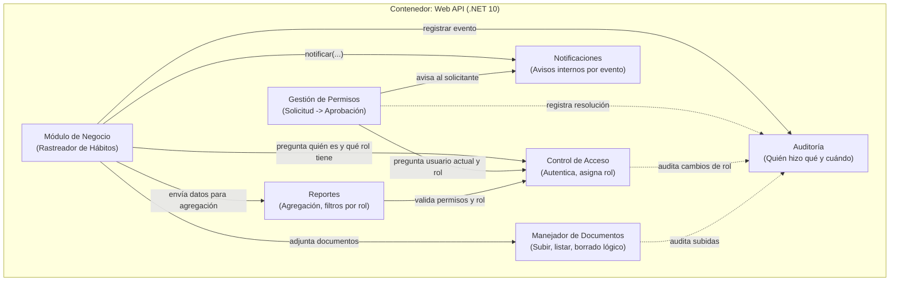

# 🎯 HabitTracker Nexus - Sistema de Gestión de Hábitos

[](https://github.com/J-bot-oss-code/HabitTracker-Arquitectura/actions/workflows/ci.yml)
[](https://github.com/J-bot-oss-code/HabitTracker-Arquitectura/actions/workflows/seguridad.yml)

Plataforma de alta fidelidad para el registro de hábitos diarios, organización de metas y trazabilidad del progreso a lo largo del tiempo. Proyecto desarrollado en .NET 10 siguiendo estrictamente los principios de **Clean Architecture** y el patrón de **Monolito Modular**.

## 🏗️ Arquitectura de Componentes (C4 - Nivel 3)

El sistema opera bajo un único contenedor (Web API) dividido en 7 módulos completamente independientes. No existen bases de datos compartidas internamente ni dependencias cíclicas.

> **Nota:** El módulo `DocManager` reflejado en el diagrama corresponde al directorio físico `Modules/DocumentManager`.



## Contenedor

El proyecto completo (la API y su base de datos SQL Server) corre en contenedores. Para levantarlo **no hace falta instalar nada salvo Docker** (Docker Desktop, o Docker Engine con Compose v2).

### Levantar el proyecto

Desde la carpeta del repositorio:

```bash
# 1) Copia el archivo de ejemplo. Es el único paso previo.
copy .env.example .env          # Windows (CMD o PowerShell)
cp .env.example .env            # Linux / macOS

# 2) Un solo comando construye la imagen y arranca todo.
docker compose up --build
```

- La **primera vez** tarda varios minutos (descarga SQL Server y compila la API). Está listo cuando el log muestra `Now listening on: http://[::]:8080`. Las migraciones, el Administrador inicial y la Meta de demostración se crean solos al arrancar: no hay que crear la base ni ejecutar scripts.
- **Dirección donde responde:** `http://localhost:8080`
- **Swagger (para probar la API):** `http://localhost:8080/swagger` (botón *Authorize* → `Bearer {token}`).
- **Detener el proyecto:** `Ctrl+C` en la terminal donde corre, o desde otra terminal `docker compose down`. Esto **conserva** los datos. Solo `docker compose down -v` borra los volúmenes y empieza de cero.

Solo la aplicación publica un puerto (el `8080`). La base de datos **no** es accesible desde fuera de la composición: la API la encuentra por el nombre del servicio (`Server=db`), no por `localhost`.

### Datos de partida

Los valores del `.env.example` son de ejemplo para esta demostración; cámbialos en tu `.env` si lo usas en serio.

| Dato | Valor |
|---|---|
| Administrador inicial | `admin@ejemplo.com` / `Ejemplo_Admin_2026!` (variables `ADMIN_CORREO` y `ADMIN_CLAVE`) |
| Meta de demostración (para crear hábitos) | `5f1c0a00-0000-4000-8000-000000000002` |

### Correos (activación de cuenta y recuperación de contraseña)

No hay un servidor de correo en la composición. Con `CORREO_MODO=consola` y `SMTP_HOST` vacío (valores del `.env.example`) el sistema **escribe el correo en el log** en lugar de enviarlo. Para leerlo:

```bash
docker compose logs webapi | findstr "CORREO"            # Windows CMD
docker compose logs webapi | Select-String "CORREO"      # PowerShell
docker compose logs webapi | grep CORREO                 # Linux / macOS
```

- **Activación:** el correo trae un **código de 6 dígitos** (vence en 24 horas) y un botón con el enlace `http://localhost:8080/api/auth/activate?correo=...&codigo=...`. El enlace abre una página con un botón **"Activar mi cuenta"**; abrirlo no activa nada (un escáner de correos no puede activar la cuenta ni gastar intentos), la activación ocurre al pulsar el botón. También puedes enviar `{"correo":"...","codigo":"123456"}` a `POST /api/auth/activate`. El código se valida siempre junto al correo; tras **5 códigos incorrectos** se invalida y hay que pedir otro con `POST /api/auth/resend-activation` (como máximo uno por minuto). Activación y reenvío admiten como máximo 30 peticiones por minuto desde una misma IP (después responden `429`).
- **Recuperación de contraseña:** el cuerpo trae un código de seis caracteres para `POST /api/auth/reset-password`.

Si rellenas los cuatro `SMTP_*` del `.env`, los correos se envían de verdad. Es un canal de desarrollo: en producción no deben escribirse enlaces ni códigos en el log.

### Los datos sobreviven

Hay dos volúmenes con nombre, fuera de la imagen y separados entre sí:

| Volumen | Contenido |
|---|---|
| `documentos-archivos` | Los archivos de los documentos (`/app/data/documentos`, RF-DOC-05) |
| `sqlserver-datos` | La base de datos: usuarios, solicitudes, hábitos y el registro de los documentos (RD-09) |

Prueba de persistencia: sube un documento, ejecuta `docker compose down` (**sin** `-v`), vuelve a ejecutar `docker compose up`; el documento sigue en el listado, se descarga y el usuario inicia sesión.

### Notas

- La composición está pensada para **una sola réplica** de la API y para demostración o uso local: el contenedor escucha HTTP sin TLS. Para otro uso, ponle un proxy con HTTPS delante y define `SWAGGER_HABILITADO=false`.
- Si el puerto `8080` ya está ocupado, libéralo antes de arrancar.
- SQL Server solo tiene imagen `linux/amd64`; en Mac con chip Apple se ejecuta emulado y tarda más.
- Evita los caracteres `$`, `;`, `=` y comillas en los valores del `.env`.
- El `.env` real no se versiona (`.gitignore`); el repositorio solo contiene `.env.example`.

## API externa

El proyecto usa la API de clima **OpenWeatherMap** (`https://api.openweathermap.org/data/2.5/weather`), que exige una clave.

| | |
|---|---|
| **Operación que la usa** | `GET /api/habits/plan-del-dia?ciudad=Santo Domingo` (rol Estándar) |
| **Variable de entorno** | `OPENWEATHER_API_KEY` (llega al contenedor desde el `.env`, que no se versiona) |
| **Clave gratuita** | https://openweathermap.org/api (la activación puede tardar hasta un par de horas) |

**Qué hace.** No reenvía la respuesta de la API. Toma los hábitos **activos** del usuario, consulta el clima de su ciudad y aplica las reglas de negocio de `RecomendadorClima`: si hay precipitación, más de 35 °C o menos de 5 °C recomienda hacerlos **bajo techo**, si no, **al aire libre**; y sugiere agua adicional según el calor (+250 ml desde 25 °C, +500 ml desde 30 °C, +1000 ml sobre 35 °C).

**Ejemplo de respuesta real** (obtenida el 04-11-2026 con una clave activa; la clave nunca aparece en la respuesta ni en los logs).

Lo que devuelve OpenWeatherMap a `GET https://api.openweathermap.org/data/2.5/weather?q=Santo Domingo&units=metric&lang=es&appid=<CLAVE>` (recortado a los campos relevantes):

```json
{
  "weather": [ { "id": 501, "main": "Rain", "description": "lluvia moderada", "icon": "10d" } ],
  "main": { "temp": 31.4, "feels_like": 38.4, "humidity": 73, "pressure": 1010 },
  "name": "Santo Domingo",
  "cod": 200
}
```

Lo que devuelve **nuestra operación** `GET /api/habits/plan-del-dia?ciudad=Santo Domingo` (usuario Estándar con un hábito activo «Correr 5 km»):

```json
{
  "ciudad": "Santo Domingo",
  "clima": { "temperaturaC": 31.4, "precipitacion": true, "descripcion": "lluvia moderada" },
  "aguaAdicionalMl": 500,
  "habitos": [
    {
      "habitoId": "349d13fe-760e-4eee-9997-7c8e0807f36c",
      "nombre": "Correr 5 km",
      "lugarSugerido": "BajoTecho",
      "motivo": "Hay precipitación: conviene hacerlo bajo techo."
    }
  ]
}
```

El código `501` (lluvia) marca `precipitacion: true`, por eso la recomendación es «bajo techo»; los 31.4 °C suman 500 ml de agua extra (≥ 30 °C).

**Sin clave o con la API caída.** Si `OPENWEATHER_API_KEY` no está definida, es inválida, el proveedor no responde o supera 5 segundos, la operación responde un rechazo controlado y el resto del proyecto sigue funcionando:

```json
{ "status": 503, "title": "Servicio no disponible.",
  "detail": "El servicio de clima no está disponible en este momento. Inténtelo de nuevo más tarde." }
```

Si el proveedor no conoce la ciudad responde `404`; una ciudad con caracteres no válidos o vacía, `400`. La clave nunca se escribe en el código, en el `Dockerfile`, en el `docker-compose.yml`, en la imagen, en los logs ni en los mensajes de error.

## Manejador de documentos

Pieza 3 del Core (RF-DOC-01 a RF-DOC-05). **Todas las operaciones exigen sesión** (`Authorization: Bearer <token>`); la identidad y el rol se leen del token firmado, nunca de la petición.

| Operación | Endpoint | Regla |
|---|---|---|
| Subir (RF-DOC-01) | `POST /api/documents` (`multipart/form-data`, campo `archivo`) | Guarda nombre, tipo, tamaño, fecha UTC y quién lo subió. Hasta 10 MB; extensiones `.pdf .png .jpg .jpeg .txt .docx .xlsx`. Archivo ausente o vacío → `400` controlado |
| Listar (RF-DOC-02) | `GET /api/documents` | Sin eliminados; el Estándar solo ve los suyos, el Administrador ve todos |
| Consultar | `GET /api/documents/{id}` | Dueño o Administrador; otro usuario → `403` |
| Descargar (RF-DOC-03) | `GET /api/documents/{id}/download` | Dueño o Administrador; otro usuario → `403` |
| Eliminar (RF-DOC-04) | `DELETE /api/documents/{id}` | Dueño o Administrador. **Eliminación lógica**: deja de listarse, pero el registro sigue en la tabla `Documentos` (`Eliminado = 1`) y el archivo sigue en el volumen. Un documento eliminado responde `404` |

Ejemplo con cURL (sustituye `TOKEN`):

```bash
curl -X POST http://localhost:8080/api/documents -H "Authorization: Bearer TOKEN" -F "archivo=@informe.pdf"
curl http://localhost:8080/api/documents -H "Authorization: Bearer TOKEN"
curl -OJ http://localhost:8080/api/documents/ID/download -H "Authorization: Bearer TOKEN"
curl -X DELETE http://localhost:8080/api/documents/ID -H "Authorization: Bearer TOKEN"
```

El nombre con el que se guarda cada archivo en el volumen es un GUID generado por el servidor, nunca el nombre que escribió el usuario. La auditoría de subidas y eliminaciones (RF-DOC-06) llega con la Pieza 6.

## Revisión acumulada desde el contenedor (Práctica 4)

Con el proyecto levantado (`http://localhost:8080/swagger`), los seis frentes:

1. **Registro con activación por correo:** `POST /api/auth/register` → leer el código de 6 dígitos en `docker compose logs webapi` → `POST /api/auth/activate` con `{"correo":"...","codigo":"..."}` (o abrir el enlace del correo).
2. **Inicio y cierre de sesión:** `POST /api/auth/login` (`{"email","password"}`) → `GET /api/auth/me` → `POST /api/auth/logout` → `GET /api/auth/me` responde `401`.
3. **Estándar contra una operación de Administrador:** con el token de un usuario Estándar, `GET /api/admin/usuarios` responde `403`.
4. **Recuperación de contraseña:** `POST /api/auth/forgot-password` → leer el código en el log → `POST /api/auth/reset-password`.
5. **Gestión de permisos:** `POST /api/permissions` (`{"permisoSolicitado":"Habits.AdvancedReconfig"}`); con el token del Administrador inicial, `POST /api/permissions/{id}/approve` o `/reject` (`{"motivoRechazo":"..."}`). Resolver dos veces, o aprobar una solicitud propia, se rechaza (`400`).
6. **Módulo de negocio (hábitos):** con un usuario Estándar, `POST /api/habits` usando como `metaId` la Meta de demostración; `POST /api/habits/{id}/transition` con `{"nuevoEstado":"Activo"}` funciona y `{"nuevoEstado":"Completado"}` desde `Planificado` se rechaza (`400`).

## 🚀 Compilación y Ejecución

Para trabajar con este proyecto, asegúrate de tener instalado el SDK de .NET 10 o superior.

```bash
# Compilar la solución entera
dotnet build HabitTrackerSystem.slnx

# Ejecutar la Web API localmente
dotnet run --project Host/WebApi/WebApi.csproj

# Ejecutar toda la suite de pruebas unitarias
dotnet test
```

## Pruebas

Ejecuta toda la suite de pruebas unitarias con:

```bash
dotnet test
```

La suite prueba directamente las capas de aplicación, dominio e infraestructura: no inicia la API ni necesita una base de datos externa. Las pruebas de persistencia usan SQLite en memoria.

> **Nota (Windows):** clona el repositorio en una ruta corta (por ejemplo `C:/src/HabitTracker`). Con rutas de más de 260 caracteres, la DLL nativa de SQLite (`e_sqlite3`) no se carga y las pruebas de persistencia fallan con "The filename or extension is too long".

### Comprobación de la entrega desde un clon limpio

Clona el repositorio y, desde su raíz, compila y verifica primero la etiqueta correcta:

```bash
git clone https://github.com/J-bot-oss-code/HabitTracker-Arquitectura.git
cd HabitTracker-Arquitectura
git fetch origin --tags
git checkout --detach practica-2
dotnet build HabitTrackerSystem.slnx
dotnet test
```

El tag revisado `practica-2` contiene 39 pruebas. Cada tag `practica-2-defecto-N` es un commit hijo directo de esa base y planta un solo defecto en código de producción de Gestión de Permisos. La suite debe pasar completa en `practica-2` y fallar al menos una prueba en cada tag de defecto; esos fallos son intencionales:

```bash
git checkout --detach practica-2-defecto-1
dotnet test
```

Repite el comando para `practica-2-defecto-2` hasta `practica-2-defecto-6` y compara el nombre de la prueba fallida con la tabla `Defectos`. Para verificar la forma del commit de cada mutante:

```bash
git show -s --format="%H %P %s" practica-2-defecto-1
git diff --stat practica-2 practica-2-defecto-1
git diff practica-2 practica-2-defecto-1 -- Modules/Permissions/
```

El único padre mostrado debe ser el commit de `practica-2`. El `--stat` debe listar un solo archivo productivo de Gestión de Permisos y ningún archivo de pruebas; inspecciona el diff para confirmar que contiene únicamente el defecto descrito. Repite las tres comprobaciones para los seis tags.

## Defectos — Práctica 2

La siguiente tabla documenta los seis defectos de la Variante A y las pruebas existentes que los detectan. Los nombres corresponden a los métodos actuales de la suite.

| Defecto Tag | Requisito | Archivo y Método / Línea Afectada | Prueba que lo Detecta | Comportamiento Erróneo Producido |
|---|---|---|---|---|
| `practica-2-defecto-1` | RF-GP-06 | Dominio: `Modules/Permissions/Permissions.Domain/Entities/SolicitudPermiso.cs`, método `Aprobar`, líneas 61 y 66 — reemplazar la validación de transición válida por una comprobación que solo excluya `Rechazada`. | `RF_GP_06_Aprobar_SolicitudAplicadaNoPuedeAprobarseOtraVez` | Permite aprobar otra vez una solicitud ya aplicada y sobrescribe los datos de resolución. |
| `practica-2-defecto-2` | RF-GP-06 | Dominio: `Modules/Permissions/Permissions.Domain/Entities/TransicionesSolicitudPermiso.cs`, método `EsValida` — agregar únicamente la transición directa `Rechazada` → `Aplicada`. | `RF_GP_06_Transicion_RechazadaNoPuedeIrDirectamenteAAplicada` | La máquina de estados acepta una transición prohibida desde Rechazada directamente a Aplicada. |
| `practica-2-defecto-3` | RF-GP-07 | Dominio: `Modules/Permissions/Permissions.Domain/Entities/SolicitudPermiso.cs`, método `Aprobar` — omitir la validación de auto-resolución. | `RF_GP_07_Aprobar_AdminNoPuedeResolverSuPropiaSolicitud` | Un Administrador puede aprobar su propia solicitud. |
| `practica-2-defecto-4` | RF-GP-02 | Infraestructura: `Modules/Permissions/Permissions.Infrastructure/Repositories/SolicitudPermisoRepository.cs`, método `GetBySolicitanteAsync` — invertir el filtro de solicitante. | `RF_GP_02_Repository_FiltraPorSolicitanteYEstadoEnLaBaseDeDatos` | Un usuario Estándar recibe solicitudes ajenas en lugar de ver únicamente las propias. |
| `practica-2-defecto-5` | RF-GP-06 | Dominio: `Modules/Permissions/Permissions.Domain/Entities/TransicionesSolicitudPermiso.cs`, método `EsValida` — agregar la transición `Aprobada` → `Pendiente`. | `RF_GP_06_Transicion_AprobadaNoPuedeVolverAPendiente` | Una solicitud aprobada puede volver al estado Pendiente. |
| `practica-2-defecto-6` | RF-GP-04 | Dominio: `Modules/Permissions/Permissions.Domain/Entities/SolicitudPermiso.cs`, método `Rechazar` — omitir la asignación de `MotivoRechazo`. | `RF_GP_04_Rechazar_ConMotivoRegistraResolucionYEstadoRechazado` | La solicitud queda rechazada, pero el motivo enviado no se conserva. |

## 🗂️ Modelo de Datos del Negocio (Rastreador de Hábitos)

El módulo de negocio está estructurado sobre 6 entidades que modelan la trazabilidad completa de hábitos, metas y progreso del usuario.

| Entidad | Descripción | Relaciones |
|---|---|---|
| **`Categoria`** | Agrupa hábitos por tipo de actividad (ej. salud, productividad, finanzas). | Tiene muchas `Metas` asociadas. |
| **`Meta`** | Representa un objetivo a alcanzar con un título, estado y fecha límite. | Pertenece a una `Categoria`, contiene `Habitos` y `Recompensas`. |
| **`Habito`** | Define la acción diaria repetible con su nombre y frecuencia de ejecución. | Pertenece a una `Meta`, tiene `RegistrosDiarios` y `Etiquetas`. |
| **`RegistroDiario`** | Registro transaccional del avance del hábito en una fecha específica (completado o no). | Pertenece a un `Habito`. |
| **`Etiqueta`** | Etiqueta descriptiva y visual que clasifica hábitos por características (ej. urgente, preferido). | Asociada a muchos `Habitos`. |
| **`Recompensa`** | Sistema de puntos canjeables por el cumplimiento de metas, incentivando la constancia. | Pertenece a una `Meta`. |

**Flujo de relaciones:** `Categoria` → `Meta` → `Habito` → `RegistroDiario`, con `Etiqueta` y `Recompensa` como referencias transversales a `Habito` y `Meta` respectivamente. Desde HabitTracker v2 la meta de un hábito es opcional.

**Perfil y salud (HabitTracker v2, Fase 2).** Cada persona tiene, como mucho, una fila de cada:
- **`PerfilUsuario`** (nivel 1 obligatorio: perfil laboral, zona horaria IANA y aviso de salud; el resto es opcional).
- **`CuestionarioSalud`** (tres bloques: objetivos, revisión de seguridad y condiciones o alergias). Cada bloque se guarda **cifrado** con ASP.NET Core Data Protection.
- **`RegistroPeso`** y **`MedicionCorporal`**, uno por día UTC (y por zona, en las medidas).

Las reglas de salud viven en un solo punto, `EvaluadorSalud`. Traduce las respuestas en restricciones y avisos, nunca en diagnósticos.

| Endpoint (rol `Estandar`) | Qué hace |
|---|---|
| `GET/PUT /api/profile` | Perfil. `404 perfil_no_encontrado` antes del onboarding. Un peso o una altura **nuevos** exigen el consentimiento `datosSalud`. Reenviar los ya guardados no lo exige, así que quien retiró el permiso puede seguir cambiando su jornada. |
| `GET /api/profile/health` | Bloques del cuestionario con su evaluación (nivel de precaución, restricciones, alérgenos y completitud). |
| `PUT /api/profile/health/objetivos`, `/seguridad`, `/condiciones` | Guarda un bloque. En las condiciones, «Ninguna» no se combina con otras opciones. |
| `GET/POST /api/progress/weights` | Peso, uno por día. `objetivoKg`: si se omite, se conserva; con `null`, se quita. El último peso pasa al perfil. |
| `GET/POST /api/progress/measurements` | Cintura y pecho 40–250 cm, brazo 10–100 cm y grasa 3–60 %. |

Para guardar el cuestionario, el peso o las medidas hace falta el consentimiento `datosSalud` (`409 consentimiento_salud_requerido`). Para guardar el nivel 1 del perfil no.

La descarga de datos añade la sección `perfilYSalud`, con el cuestionario descifrado para su dueño, y la baja de cuenta borra todo.

**Claves de cifrado:** se guardan en `DATAPROTECTION_KEYS_PATH`, que en Docker es el volumen `dataprotection-claves`. Fuera de Development esa ruta es obligatoria y la API no arranca sin ella. **Respalda ese volumen, pero en un sitio distinto del respaldo de la base de datos.** Si se pierden las claves, los cuestionarios no se pueden leer. Si las claves y la base se filtran juntas, el cifrado no protege nada. En esta fase las claves se guardan sin proteger dentro de su volumen; protegerlas con un certificado (`ProtectKeysWithCertificate`) queda para la Fase 6.

Solo se cifra el cuestionario. Peso, altura y medidas se guardan sin cifrar porque hacen falta para ordenar y graficar en el servidor; solo los ve su dueño (RD-06).

Si la persona retira el consentimiento `datosSalud`, sus datos no se borran y los sigue viendo, pero la evaluación deja de usarlos (`usaDatosDeSalud: false`). Un bloque que no se pueda descifrar, por ejemplo porque se perdieron las claves, se trata como no respondido: la persona lo vuelve a responder, sin recibir un 500.

## 💻 Stack Tecnológico

**Framework Principal:** .NET 10 (Web API)

**Lenguaje:** C#

**Arquitectura:** Clean Architecture (Monolito Modular)

**ORM:** Entity Framework Core

**Seguridad:** JWT (JSON Web Tokens) & Hashing (Argon2/BCrypt)

**Testing:** xUnit / Moq

## Control de Acceso: errores, límites y CORS

Reglas del módulo que conviene conocer al probar la API (las comprueban las pruebas de `AccessControl.*.Tests`).

**Códigos de error.** Los rechazos de Control de Acceso son `application/problem+json` con una extensión `codigo` estable, para distinguir el motivo sin leer el texto. Un correo o una contraseña incorrectos siguen siendo un `401` genérico que no dice cuál falló (RF-CA-03).

| `codigo` | Estado | Cuándo |
|---|---|---|
| `cuenta_no_activa` | 400 | Clave correcta en una cuenta sin activar (RF-CA-15). Con clave incorrecta no se revela. |
| `cuenta_desactivada` | 400 | Clave correcta en una cuenta desactivada por un administrador (RF-CA-20). |
| `cuenta_bloqueada` | 400 | 5 intentos fallidos: bloqueo de 15 minutos (RF-CA-19). También cuenta la contraseña actual incorrecta al cambiarla. |
| `correo_ya_registrado` | 400 | Ya existe una cuenta con ese correo (RF-CA-01). Hay un índice único en la base. |
| `codigo_invalido` | 400 | Código de activación o recuperación incorrecto, usado, vencido o agotado. |
| `contrasena_no_valida` | 400 | La contraseña no tiene entre 12 y 1024 caracteres con al menos una letra y un número (RF-CA-14). |
| `contrasena_filtrada` | 400 | La contraseña aparece en filtraciones de datos conocidas. |
| `consentimiento_no_valido` | 400 | Falta aceptar las versiones **vigentes** de los Términos y de la Política de privacidad (registro) o se envió una versión que no corresponde. |
| `token_externo_invalido` | 401 | El ID token de Google no es válido (firma, emisor, vencimiento, otra aplicación) o Google no verificó el correo. No dice cuál. |
| `vinculacion_requerida` | 409 | El correo de la cuenta de Google ya tiene una cuenta con contraseña: hay que confirmarla en `POST /api/auth/google/vincular`. |
| `consentimiento_requerido` | 400 | Cuenta nueva con Google sin `consentimientos` en la petición. |
| `proveedor_ya_vinculado` | 400 | Esa identidad de Google ya es de otra cuenta, o la cuenta ya tiene otra identidad de Google. |
| `confirmacion_incorrecta` | 400 | La confirmación de la baja de cuenta con Google no sirve (token inválido o de otra cuenta). Siempre 400, nunca 401. |
| `sin_contrasena` | 400 | La cuenta entra solo con Google y no tiene contraseña actual que confirmar (puede crear una con la recuperación). |
| `ultimo_metodo_acceso` | 400 | Desvincular Google dejaría la cuenta sin ninguna forma de entrar. |
| `proveedor_no_disponible` | 503 | Falta `Google:ClientId` o no se pudo consultar a Google. |
| `sesion_invalida` | 401 | El refresh token falta, no existe, venció, fue revocado o ya se había usado; o su cuenta ya no está activa. El cliente debe iniciar sesión de nuevo. |
| `csrf_requerido` | 403 | `POST /api/auth/refresh` sin la cabecera `X-HabitTracker-Csrf: 1`. |
| `clave_actual_incorrecta` | 400 | La contraseña actual indicada al cambiarla no coincide (RF-CA-22). |
| `ultimo_administrador` | 400 | La operación dejaría al sistema sin ningún administrador activo. |
| `operacion_no_permitida` | 403 | Quien ejecuta no es un administrador activo (RF-CA-05, RF-CA-06). |

**Módulo de negocio (HabitTracker):**

| `codigo` | Estado | Cuándo |
|---|---|---|
| `habito_no_encontrado` | 404 | El hábito no existe. Uno ajeno responde `403`. |
| `perfil_no_encontrado` | 404 | La persona aún no completó el onboarding. |
| `fecha_futura` | 400 | Un avance, un peso o una medida con fecha futura (más de 5 minutos de adelanto). |
| `meta_no_encontrada` | 400 | El `metaId` indicado al crear un hábito no existe. |
| `perfil_requerido` | 400 | Se quiso fijar un peso objetivo sin tener perfil. |
| `consentimiento_salud_requerido` | 409 | Guardar un dato de salud (cuestionario, peso, medidas, o el perfil con peso o altura) sin el consentimiento `datosSalud`. |

**Límite de peticiones por IP** (después responde `429`). Se cambia en `RateLimit:*`; un valor de 0 detiene el arranque.

| Política | Endpoints | Por defecto |
|---|---|---|
| `login` | `POST /api/auth/login` | 10 por minuto |
| `registro` | `POST /api/auth/register` | 5 por minuto |
| `recuperacion` | `POST /api/auth/recuperar-password` y `restablecer-password` (y sus alias) | 5 por minuto |
| `activacion` | `activate` (GET y POST) y `resend-activation` | 30 por minuto |
| `refresh` | `POST /api/auth/refresh` | 30 por minuto |
| `google` | `POST /api/auth/google` y `/google/vincular` | 10 por minuto |
| `privacidad` | `POST /api/privacy/deletion-request` y `GET /api/privacy/export` | 10 por minuto |

> Dentro de Docker todos los clientes llegan con la IP de la pasarela y comparten el mismo cupo (deuda conocida, ver `docs/ESTADO-DEL-PROYECTO.md`).

**Política de contraseñas** (registro, restablecimiento y cambio de contraseña; RF-CA-14 pide como mínimo 8 con letras y números, esta política es más estricta). Debe tener **12 a 1024 caracteres con al menos una letra y un número** y **no aparecer en filtraciones conocidas**. La comprobación usa la API pública *Pwned Passwords* con k-anonimato: solo viaja un prefijo de 5 caracteres del hash SHA-1, nunca la contraseña. Si la API falla o tarda más de 3 segundos, **la contraseña se permite** (una caída externa no bloquea registros). Se desactiva con `Seguridad:ContrasenasFiltradas:Habilitado=false` (`CONTRASENAS_FILTRADAS=false` en Docker) y solo comprueba el formato. Las cuentas existentes con contraseñas más cortas siguen entrando: la política solo se aplica al fijar una nueva. Un rechazo por clave filtrada no consume el código de recuperación ni cierra la sesión.

> Las contraseñas de ejemplo de esta documentación y del script de revisión (`ClaveSegura-Nexus-2026`, `ClaveNueva-Nexus-2026`, `ClaveOtra-Nexus-2026`) se eligieron porque **no aparecen en filtraciones**: `ClaveSegura123` y `NuevaClave123` sí aparecen y la política las rechaza. Al probar con otras contraseñas, evita las comunes.

**Consentimiento legal** (Ley 172-13 de la República Dominicana y GDPR: el consentimiento debe poder demostrarse). `POST /api/auth/register` exige `consentimientos: {terminosVersion, privacidadVersion, marketing}` con las **versiones vigentes** (`v2.1` y `v1.4`, configurables en `Legal:VersionTerminos` y `Legal:VersionPrivacidad`); sin ellas no se crea la cuenta (`consentimiento_no_valido`). El usuario y su consentimiento se guardan juntos: o quedan los dos o ninguno. Se guarda en un historial de **solo inserción** (cada cambio es una fila nueva; la vigente es la última) con la versión aceptada, el instante UTC que fija el servidor y el origen (`registro`, `google` o `actualizacion`).

- `GET /api/privacy/consents` devuelve el consentimiento vigente (`404` si la cuenta nunca aceptó nada, como las anteriores a esta función).
- `PUT /api/privacy/consents` actualiza `{terminosVersion, privacidadVersion, datosSalud, marketing, compartirCumplimiento, estadisticasAnonimas}` (los seis obligatorios). Acepta las versiones vigentes **o las que la persona ya había aceptado**: mover un interruptor no obliga a aceptar documentos nuevos que aún no ha visto. La fecha de aceptación solo se renueva cuando cambian las versiones.
- `POST /api/auth/login` y `GET /api/auth/me` incluyen `requiereAceptarDocumentos`: `true` si la cuenta nunca aceptó o su última aceptación no es de las versiones vigentes. El inicio de sesión funciona igual: el cliente decide cuándo pedir la aceptación.

**Sesiones** (RF-CA-03, RF-CA-12, RF-CA-18, RF-CA-20). El token de acceso (JWT) dura **15 minutos** y viaja en el cuerpo del login, como siempre. Para no pedir la contraseña cada 15 minutos, el login también abre una *sesión* y fija una cookie con un **refresh token** rotativo:

- La cookie `habittracker_refresh` es **HttpOnly** (el JavaScript de la página no la lee, así un XSS no la roba), **Secure**, `SameSite=Strict` y solo viaja a `/api/auth` (el resto de la API nunca la recibe). En la base de datos solo se guarda el **hash SHA-256** del token (tabla `SesionesUsuario`); el valor son 32 bytes aleatorios en Base64Url. Dura 14 días sin usarse.
- `POST /api/auth/refresh` canjea el refresh token por un token de acceso nuevo **y un refresh token nuevo**: el anterior queda revocado. Como se autentica solo con la cookie exige la cabecera `X-HabitTracker-Csrf: 1` (un formulario de otro sitio no puede enviarla y CORS impide que un script de otro origen la envíe); sin ella responde `403 csrf_requerido`.
- **Reutilización = robo:** si llega un refresh token que ya fue canjeado, se revoca **toda la familia** de sesiones de ese inicio de sesión y hay que volver a entrar. Dos renovaciones simultáneas con el mismo token tampoco ganan las dos: gana una y la otra cierra la familia (el cliente debe serializar sus renovaciones). La cuenta desactivada, bloqueada o dada de baja no puede renovar.
- `POST /api/auth/logout` invalida el token de acceso (RF-CA-18) y revoca el refresh token de la cookie. `POST /api/auth/logout-todas` cierra la sesión en todos los dispositivos. Ambos se autorizan con el Bearer, no con la cookie.
- `GET /api/auth/sesiones` lista las sesiones abiertas (`id`, `dispositivo`, `creadaEn`, `ultimoUsoEn`, `actual`) y `DELETE /api/auth/sesiones/{id}` cierra una (`404` si no existe o es de otra persona). El token de acceso de una sesión cerrada así sigue sirviendo hasta que venza (máximo 15 minutos); `logout-todas` sí corta también los accesos emitidos.
- Cambiar o restablecer la contraseña, forzar el restablecimiento, desactivar la cuenta o cambiar el rol revocan **todas** las sesiones (refresh y accesos) por un único punto: `IGestorSesiones.RevocarTodasAsync`.
- Las sesiones vencidas hace más de 30 días se borran al iniciar otra. Detrás de un proxy (como Docker) la IP que se guarda es la de la pasarela (deuda conocida).
- Configuración: `Sesion:DiasRefresh` (1-90), `Sesion:CookieSegura` (solo `false` en desarrollo sin HTTPS) y `Sesion:CookieSameSite` (`Strict`, `Lax` o `None`; `None` exige cookie segura y es lo que hace falta si el frontend y la API están en dominios distintos). Una configuración inválida detiene el arranque.

**Inicio de sesión con Google** (RF-CA-01, RF-CA-03). Flujo de Google Identity Services: el navegador obtiene un **ID token** y lo envía a la API, que lo valida con la librería oficial (`Google.Apis.Auth`: firma con las claves públicas de Google, emisor `accounts.google.com`, vencimiento y que fue emitido para nuestra aplicación, `Google:ClientId`). No usa secreto de cliente ni redirecciones. Un correo que Google no verificó (`email_verified=false`) no sirve. La persona se identifica por el `sub` de Google, no por el correo.

- `POST /api/auth/google` `{idToken, consentimientos?}` abre la misma sesión que el login (token de acceso en el cuerpo y cookie del refresh token):
  1. **La identidad ya está vinculada:** inicia sesión (`200`) con las reglas del login (cuenta bloqueada, desactivada por un administrador).
  2. **El correo ya tiene una cuenta con contraseña:** `409 vinculacion_requerida`, sin sesión. Nunca se vincula sola.
  3. **Correo nuevo:** crea la cuenta (`201`), **activa** desde el principio y **sin contraseña** (RF-CA-15 se refiere al registro con correo; aquí es Google quien verifica que la persona controla el correo). Exige `consentimientos {terminosVersion, privacidadVersion, marketing}` con las versiones vigentes (sin ellos, `400 consentimiento_requerido`) y los guarda con origen `google`, junto con la cuenta y el vínculo en una sola operación.
- `POST /api/auth/google/vincular` `{idToken, password}` vincula Google a la cuenta con contraseña de ese mismo correo. **Pide la contraseña**: sin ella, quien controlara ese correo en Google podría apoderarse de una cuenta ajena. Una clave incorrecta cuenta para el bloqueo de RF-CA-19. Si la cuenta esperaba su código de activación, se activa (Google acaba de verificar el correo).
- `GET /api/auth/vinculos` devuelve `{tienePassword, vinculos: [{proveedor, vinculadoEn}]}` y `DELETE /api/auth/vinculos/google` desvincula. Solo se permite si la cuenta tiene contraseña (`ultimo_metodo_acceso` si no).
- **Cuenta sin contraseña** (solo Google): el login con contraseña responde el `401` genérico de siempre (sin contar para el bloqueo); `cambiar-password` responde `sin_contrasena`; y la recuperación de contraseña le permite **crear** una (mismos pasos de RF-CA-09 a RF-CA-11).
- Configuración: `Google:ClientId` (ver arriba). Para crearlo: Google Cloud Console → proyecto → Pantalla de consentimiento de OAuth (Externo, en Prueba, con tu correo como usuario de prueba) → Credenciales → ID de cliente de OAuth, **Aplicación web**, con los orígenes de JavaScript autorizados `http://localhost:5173` y `http://localhost:5174` (y el dominio de producción más adelante). No hace falta URI de redirección ni secreto de cliente.

**Baja de cuenta y descarga de datos** (Ley 172-13 de la República Dominicana y GDPR: derecho de acceso, portabilidad y supresión). Son para el rol **Estandar**: un administrador que se diera de baja podría dejar al sistema sin nadie que lo administre (responde `403`). La identidad sale siempre del token.

- `POST /api/privacy/deletion-request` `{modo, password}` (o `{modo, idTokenGoogle}` si la cuenta no tiene contraseña) responde `202 {modo, borradoEn}`. Dos modos:
  - `desactivar`: la cuenta queda inactiva **por su dueño** (no es la desactivación de un administrador, RF-CA-20). Vuelve a funcionar con solo **iniciar sesión** con la clave correcta (o con Google). `borradoEn` es `null`.
  - `eliminar`: programa el borrado definitivo para dentro del **periodo de gracia** (30 días por defecto, `Privacidad:DiasGraciaBaja`). Durante la gracia la cuenta sigue activa y el login funciona; la respuesta del login, del refresh y de Google trae `bajaProgramadaPara` para que el cliente ofrezca cancelar. Pedirlo otra vez conserva la fecha original.
  Ambos **revocan todas las sesiones** en el momento (hay que volver a iniciar sesión). Una confirmación incorrecta es un `400` (`clave_actual_incorrecta` o `confirmacion_incorrecta`) que **cuenta para el bloqueo** de RF-CA-19, nunca un `401`: un 401 haría que el cliente cierre la sesión de quien solo se equivocó.
- `GET /api/privacy/deletion-request` devuelve `{borradoEn}` (`404` si no hay baja programada) y `DELETE /api/privacy/deletion-request` la **cancela** (`204`; `404` si no había). Cancelar no pide la contraseña: solo conserva la cuenta.
- **Borrado definitivo:** un proceso en segundo plano (`BajaCuentasWorker`, una vez al día) busca las cuentas cuyo plazo terminó. Para cada una borra primero los datos de **cada módulo** y, solo si todos lo lograron, la cuenta con todo lo que depende de ella (consentimientos, sesiones, vínculos de Google, corte de sesiones y correos en cola). Si algo falla, se reintenta en la siguiente pasada (todos los borrados son idempotentes). Solo se registra en el log un identificador anonimizado. **Un administrador nunca se borra solo.** Una vez borrada, el correo queda libre para registrarse de nuevo.
  - Hábitos: sus hábitos y registros de avance (las metas, categorías y etiquetas son catálogos compartidos). Permisos: las solicitudes que hizo (no las que resolvió como aprobador). Documentos: los archivos del disco y los registros, **también los que ya estaban marcados como eliminados**. El borrado normal de un documento sigue siendo lógico (RF-DOC-04); esta purga solo ocurre al cerrar la cuenta, porque el derecho a la supresión obliga a que no quede nada.
- `GET /api/privacy/export` descarga un JSON (`Content-Disposition: attachment`, `Cache-Control: no-store`) con todo lo que se guarda de la persona: `cuenta`, `consentimientos` (historial completo), `vinculos`, `sesiones` (con su IP) y `modulos` con una sección por módulo (`habitos`, `permisos`, `documentos`). Nunca incluye la contraseña, su hash, el código de recuperación ni los tokens. Los documentos van como metadatos; el contenido se baja por `/api/documents/{id}/download`. Si un módulo falla, la descarga falla entera: no se entrega un archivo incompleto que parezca completo. Queda auditada.
- Estos endpoints reemplazan a `POST /api/privacy/export-request` que el frontend tenía simulado: ahora la descarga es el propio `GET`.

**Recuperación de contraseña.** El código es de 6 dígitos y vence en 1 hora; se pide como máximo una vez por minuto (dentro del minuto se responde igual pero no se envía otro correo). Con 5 códigos incorrectos se invalida. Restablecerla cierra las sesiones abiertas y levanta el bloqueo.

**Administración.** Cambiar el rol de un usuario cierra sus sesiones abiertas (el rol viaja en el JWT). No se puede quitar el rol ni desactivar al último administrador activo.

**CORS.** Solo los orígenes de `Cors:OrigenesPermitidos` (en desarrollo, `http://localhost:5173` y `:5174`; en Docker, la variable `FRONTEND_URL`). Nunca comodines; sin orígenes configurados no se permite ninguno. `GET /api/auth/me` devuelve también el `nombre`.

## Integración continua (CI)

Cada PR hacia `develop` o `main` (y cada push a esas ramas) ejecuta dos workflows de GitHub Actions. Los **checks requeridos** son `ci-ok` y `seguridad-ok`: agrupan todos los trabajos de su workflow y bloquean el merge si alguno falla. El umbral es **severidad alta y crítica**: lo que quede por debajo se reporta pero no bloquea.

| Workflow | Trabajo | Qué verifica | Bloquea el merge si… |
|---|---|---|---|
| `ci.yml` | Backend (.NET) | restore con NuGetAudit, build Release con las reglas de seguridad del compilador, las 347 pruebas, paquetes NuGet vulnerables | el build, una prueba o un paquete con vulnerabilidad alta o crítica falla |
| `ci.yml` | Frontend (React) | `npm ci` sin scripts, firmas de paquetes, lint, formato, tipos, las 452 pruebas, build, `npm audit` | cualquier paso falla o hay una vulnerabilidad alta o crítica |
| `ci.yml` | Reglas del repositorio | formato de los commits (`tipo: descripción en español [RF-XX-NN, RD-NN]`), RD-03, RD-05, RD-08, RD-10 y RD-11, ShellCheck de los scripts | un commit o el código incumple la regla |
| `seguridad.yml` | CodeQL (C#, JS/TS, Actions) | análisis estático con las consultas `security-extended` | la regla de *code scanning* del repositorio detecta una alerta alta o crítica |
| `seguridad.yml` | Secretos | gitleaks sobre los commits de la PR (y sobre todo el historial en push y cada lunes) | aparece una credencial |
| `seguridad.yml` | Revisión de dependencias | dependencias nuevas con vulnerabilidades altas o críticas | la PR añade una dependencia vulnerable |
| `seguridad.yml` | Imagen Docker | Trivy sobre el `Dockerfile` y la imagen de la API | hay una configuración insegura o una vulnerabilidad alta o crítica con parche disponible |
| `seguridad.yml` | Auditoría de workflows | actionlint y zizmor sobre los propios workflows | un workflow tiene un fallo de seguridad de severidad media o mayor |

Además, Dependabot abre cada lunes PR hacia `develop` con actualizaciones de NuGet, npm, Docker y GitHub Actions, y `seguridad.yml` se ejecuta también los lunes para detectar vulnerabilidades publicadas después del último cambio.

### Reproducir las comprobaciones en local

```bash
# Backend (desde la raíz)
dotnet restore HabitTrackerSystem.slnx
dotnet build HabitTrackerSystem.slnx -c Release --no-restore
dotnet test HabitTrackerSystem.slnx -c Release --no-build

# Frontend (desde frontend/)
npm ci --ignore-scripts && npm audit signatures
npm run lint && npm run format:check && npm run typecheck && npm test && npm run build
npm audit --audit-level=high

# Reglas del repositorio (Git Bash o Linux; requieren git y bash)
bash scripts/ci/pruebas-verificar-commits.sh
bash scripts/ci/verificar-reglas-rd.sh
bash scripts/ci/verificar-commits.sh <base> HEAD     # p. ej. develop HEAD
```

> **Windows:** `npm run format:check` falla en local si Git convirtió los archivos a CRLF (`core.autocrlf=true`); en el CI y en el índice de Git son LF y pasa. Compruébalo con `npx prettier --check . --end-of-line auto`.

### Justificar una excepción

No se suprime nada en masa. Una excepción siempre lleva su motivo escrito:

- **Secreto falso positivo:** se acota en `.gitleaks.toml` (valor y archivo exactos) o se añade su *fingerprint* a `.gitleaksignore` con un comentario `# motivo`. Si el secreto es **real**, se rota en el proveedor; no se reescribe la historia (rompería las etiquetas de entrega).
- **Vulnerabilidad de la imagen sin parche:** línea `CVE-...` en `.trivyignore` con el motivo y la fecha de revisión.
- **Regla del compilador:** `[SuppressMessage("Security", "CAxxxx", Justification = "...")]` en el sitio exacto, nunca bajar la severidad de toda la categoría.
- **Alerta de CodeQL:** descartar en GitHub (*Security → Code scanning → Dismiss*) indicando el motivo, y anotarlo en `docs/ESTADO-DEL-PROYECTO.md`.

## 🤝 Guía de Colaboración (Workflow del Equipo)

Para garantizar el cumplimiento de los Requisitos de Diseño (RD) del contrato, todos los miembros del equipo deben adherirse a las siguientes directrices:

### 1. Flujo de Control de Versiones (Git Flow)

- Prohibido subir a main directamente. Todo desarrollo ocurre en la rama develop.
- Cada nueva pieza o característica se desarrolla en una rama aislada (ej. `feat/access-control` o `fix/user-login`).
- Los commits deben incluir el identificador del requisito funcional que resuelven (ej. `feat: hashear contraseña en registro [RF-CA-02]`).
- Toda rama debe ser integrada mediante un Pull Request (PR) y revisada por el otro miembro del equipo.

### 2. Reglas de Programación por Módulos

- **Cero código compartido genérico:** Está estrictamente prohibido crear carpetas como `Utils`, `Helpers` o `Common`. Cada módulo guarda lo suyo.
- **Separación de capas:** La lógica de negocio vive obligatoriamente en `Core.Application` o `Core.Domain`. Nunca en los controladores HTTP de la API (RD-02).
- **Fechas:** Todo registro de fecha en el sistema debe generarse utilizando `DateTime.UtcNow` (RD-11).

### 3. Comunicación entre Módulos

- **Prohibido cruzar fronteras de datos:** Un módulo NUNCA debe hacer un SELECT directo a las tablas de otro módulo.
- **Inyección de dependencias:** Si HabitTracker necesita saber quién está logueado, debe inyectar la interfaz expuesta por AccessControl y solicitar la información. La dependencia viaja en un solo sentido.

### 4. Estrategia de Pruebas (Testing)

- **Aislamiento (RD-12):** Cada pieza del Core debe poder probarse sin levantar la aplicación completa.
- Toda máquina de estados (Permisos y Metas) debe contar con pruebas unitarias en xUnit que validen transiciones permitidas y rechacen transiciones prohibidas antes de integrarse con la base de datos.

## Evaluación de Práctica 1 (Control de Acceso y Hábitos)

### Requisitos Previos y Variables de Entorno
Para ejecutar este proyecto, necesitas configurar User Secrets o variables de entorno locales. **Nunca incluyas valores reales en el código fuente.**

*   `ConnectionStrings:AccessControl`: (String) Cadena a SQL Server con autenticación de Windows, sin contraseña en el repo. Ejemplo: `Server=.\SQLEXPRESS;Database=HabitTracker;Trusted_Connection=True;TrustServerCertificate=True` (o `Server=(localdb)\MSSQLLocalDB;...`).
*   `JwtSettings:Clave`: (String) Clave secreta de al menos 32 caracteres para firmar los tokens JWT. Solo vía User Secrets: `dotnet user-secrets set "JwtSettings:Clave" "tu-clave..." --project Host/WebApi/WebApi.csproj`.
*   `JwtSettings:Emisor`: (String) Emisor del token (ej. `HabitTrackerNexus`).
*   `JwtSettings:Audiencia`: (String) Audiencia del token (ej. `HabitTrackerNexusApi`).
*   `JwtSettings:MinutosExpiracion`: (int) Vida del token de acceso en minutos (por defecto `15`; la sesión larga la sostiene el refresh token, ver «Sesiones»).
*   `Sesion:DiasRefresh`, `Sesion:CookieSegura`, `Sesion:CookieSameSite`: (opcionales) vida del refresh token (14 días), cookie `Secure` (`true`) y `SameSite` (`Strict`; `None` si el frontend y la API están en dominios distintos).
*   `Google:ClientId`: (String, opcional) ID de cliente de Google para "Continuar con Google" (`xxxx.apps.googleusercontent.com`). No es un secreto, pero no se versiona: `dotnet user-secrets set "Google:ClientId" "<id>" --project Host/WebApi/WebApi.csproj`, o `GOOGLE_CLIENT_ID` en el `.env` de Docker. Sin él, `POST /api/auth/google` responde `503` y el resto de la API funciona.
*   `Privacidad:DiasGraciaBaja`, `Privacidad:IntervaloEjecucionMinutos`: (opcionales) días de gracia antes de borrar una cuenta cuya eliminación se pidió (`30`, de 0 a 365; `DIAS_GRACIA_BAJA` en Docker) y cada cuántos minutos el proceso en segundo plano busca cuentas vencidas (`1440`, una vez al día; `BAJAS_INTERVALO_MINUTOS` en Docker).
*   `SMTP_HOST`, `SMTP_PORT`, `SMTP_USER`, `SMTP_PASS`: (String) Credenciales del servidor de correo saliente, solo por variables de entorno o User Secrets.
*   `App:BaseUrl`: (String) URL pública de la API para armar el enlace de activación del correo (ej. `http://localhost:5246`).

### Instrucciones de Ejecución
1. Restaura las herramientas y paquetes: `dotnet restore`
2. Aplica las migraciones a tu base de datos local (SQL Server):
   `dotnet ef database update --project Modules/AccessControl/AccessControl.Infrastructure --startup-project Host/WebApi --context ApplicationDbContext`
   `dotnet ef database update --project Modules/HabitTracker/HabitTracker.Infrastructure --startup-project Host/WebApi --context HabitTrackerDbContext`
   `dotnet ef database update --project Modules/Permissions/Permissions.Infrastructure --startup-project Host/WebApi --context PermissionsDbContext`
3. Levanta la API:
   `dotnet run --project Host/WebApi/WebApi.csproj`
4. Abre Swagger en `http://localhost:5246/swagger` (usa el botón Authorize con `Bearer {token}`).

### Guía de Pruebas (Criterios de Aceptación)
Sigue estas instrucciones desde Swagger o Postman para validar la rúbrica:

Configura `ConnectionStrings:AccessControl`, la clave JWT y aplica las tres migraciones siguiendo las instrucciones anteriores. Ejecuta `dotnet run --project Host/WebApi/WebApi.csproj` y abre `http://localhost:5246/swagger` en el entorno local de desarrollo. En Swagger, usa **Authorize** y pega `Bearer ` seguido del JWT obtenido al iniciar sesión. No compartas ni publiques ese token. Para estas comprobaciones, usa cuentas de prueba con correos distintos y activa cada cuenta antes de iniciar sesión.

* **Inicio de sesión, claims y expiración:** ejecuta `POST /api/auth/login` con las credenciales de una cuenta activa; autoriza Swagger con el JWT recibido y ejecuta `GET /api/auth/me` para comprobar el id, correo y rol autenticados. Inspecciona localmente el payload del JWT y confirma que contiene los datos de identidad y una expiración futura (`exp`). No publiques el JWT. Ejecuta `POST /api/auth/logout`; el mismo token debe quedar invalidado y `GET /api/auth/me` debe responder `401`.
*   **Registro y rechazo controlado:** Usa `POST /api/auth/register` con una clave menor a 8 caracteres o sin números. Recibirás un error 400 controlado.
*   **Encolado de correos (Sin SMTP):** Si el servidor SMTP no está configurado o falla, el registro (201 Created) y la recuperación de clave terminan con éxito. Los correos quedan pendientes en la tabla/cola interna.
*   **Registro y activación por correo:** Envía `POST /api/auth/register` con `{"nombre":"Persona de prueba","correo":"persona@ejemplo.com","password":"ClaveSegura-Nexus-2026","consentimientos":{"terminosVersion":"v2.1","privacidadVersion":"v1.4","marketing":false}}`. El usuario se crea inactivo y se encola el mensaje de activación. Obtén el **código de 6 dígitos** del correo o, en desarrollo local sin SMTP, consulta `usuarios.TokenAcceso` o `CorreosEnCola.Cuerpo` en la base AccessControl (con Docker, `docker compose logs webapi`). Activa la cuenta con `POST /api/auth/activate` y `{"correo":"persona@ejemplo.com","codigo":"CODIGO_RECIBIDO"}`. La cuenta queda activa; reutilizar el código se rechaza.

    ```sql
    SELECT TokenAcceso, Vencimiento
    FROM usuarios
    WHERE Correo = N'persona@ejemplo.com';
    ```

*   **Inicio y cierre de sesión:** Inicia sesión con `POST /api/auth/login` y `{"email":"persona@ejemplo.com","password":"ClaveSegura-Nexus-2026"}`. Guarda el JWT recibido, úsalo como `Authorization: Bearer <JWT>` para `GET /api/auth/me` y luego envíalo en `POST /api/auth/logout`. Repite `GET /api/auth/me` con el mismo token: debe responder `401 Unauthorized`.
*   **Seguridad de enumeración (Recuperación):** Llama a `POST /api/auth/recuperar-password` con un correo falso y luego con uno registrado. Ambos reciben `200 OK` con el mismo mensaje; el servidor aplica un tiempo mínimo de respuesta para reducir diferencias de temporización.
*   **Recuperación de contraseña paso a paso:** Envía `POST /api/auth/forgot-password` con `{"correo":"persona@ejemplo.com"}`. El endpoint responde siempre `200 OK` con un mensaje genérico. Para una cuenta existente, el código de seis caracteres se envía por correo. En un entorno local sin SMTP operativo, consulta la cola de correos de la base `AccessControl`; el cuerpo HTML de `CorreosEnCola` contiene el código:

    ```sql
    SELECT TOP (10) Id, Destinatario, Asunto, Cuerpo, Estado, FechaCreacion
    FROM CorreosEnCola
    WHERE Destinatario = N'persona@ejemplo.com'
    ORDER BY FechaCreacion DESC;
    ```

    Usa el código recibido en `POST /api/auth/reset-password` con `{"correo":"persona@ejemplo.com","codigo":"CODIGO_DE_SEIS_CARACTERES","nuevaPassword":"ClaveNueva-Nexus-2026"}`. La respuesta exitosa es `200 OK`; el código es de un solo uso y el cambio invalida las sesiones anteriores. Los nombres en español `POST /api/auth/recuperar-password` y `POST /api/auth/restablecer-password` son rutas equivalentes. Trata el código como una credencial temporal: consulta la cola solo en la base local de desarrollo y no copies su contenido a logs o reportes.
*   **Bloqueo de fuerza bruta (15 min):** Falla cinco veces seguidas en `POST /api/auth/login`; la cuenta queda bloqueada. El siguiente inicio se rechaza incluso si se usa la contrasena correcta.
*   **Invalidación de sesión (Logout / Cambio de Rol/Clave):** Inicia sesión, guarda el JWT. Llama a `POST /api/auth/logout`. Vuelve a intentar usar el JWT en `GET /api/auth/me`; recibirás un `401 Unauthorized`.
*   **Protección por Roles:** En la base de datos local de pruebas, promueve una cuenta activada a Administrador (`UPDATE usuarios SET Rol = 2 WHERE Correo = 'admin@ejemplo.com'`; el valor 2 corresponde a `Administrador`). Inicia sesión de nuevo con esa cuenta para obtener un JWT con el rol actualizado. Autoriza Swagger con el JWT de otra cuenta Estándar e invoca `GET /api/admin/usuarios`: debe responder `403 Forbidden`. Autoriza después con el token de Administrador y la misma operación debe responder `200 OK`. No ejecutes la actualización SQL en una base compartida o de producción.
*   **Desactivación y Autodesactivación:** Como Administrador, intenta desactivarte a ti mismo en `PATCH /api/admin/usuarios/{tu_id}/estado`. El sistema lo rechazará. Desactiva a otro usuario y sus sesiones abiertas morirán instantáneamente.

---
*Documentación de la Máquina de Estados disponible en `docs/maquina-de-estados.md`.*

---

## Práctica 3 — Módulo de Negocio (Habit Tracker)

Pieza del Core con máquina de estados propia (`Planificado → Activo → Pausado → Activo → Completado`; `Completado` único terminal). Capas: `HabitTracker.Domain` (entidad rica `Habito` + `TransicionesHabito` + `Periodicidad`), `HabitTracker.Application` (`HabitoService` con 5 casos de uso), `HabitTracker.Infrastructure` (`HabitTrackerDbContext` propio + `HabitoRepository` + `MetaRepository` + `HabitTrackerUnitOfWork`) y endpoints en `HabitsController` (`api/habits`) protegidos con JWT y rol `Estandar`.

### Pruebas

```bash
# Suite completa con un solo comando (106 pruebas, sin levantar la API ni una BD externa)
dotnet test
```

La suite incluye pruebas unitarias de dominio (43), aplicación (21), integración real con Gestión de Permisos (1), persistencia real de avances con EF Core/SQLite (2), Control de Acceso (12) y Gestión de Permisos (27). Las pruebas usan dobles de prueba o componentes en memoria/SQLite; no inician la API ni requieren una base de datos externa.

### Máquina de estados

La entidad central es `Habito`. Exactamente cuatro estados: `Planificado` (inicial), `Activo`, `Pausado` y `Completado` (único terminal). Las transiciones se deciden en un solo punto: `TransicionesHabito.EsTransicionValida`. Detalle completo en `docs/maquina-de-estados.md`.

### Las cinco funcionalidades separables (RF-NEG-02)

Cada operación se puede provocar y verificar por separado. Requieren JWT válido y rol `Estandar`. La identidad y `usuarioActualId` se obtienen de los claims autenticados, nunca del cuerpo de la petición.

| ID | Funcionalidad y ruta | Comportamiento |
|---|---|---|
| RF-NEG-02.1 | Crear hábito — `POST /api/habits` | Crea para el usuario autenticado un hábito con nombre, periodicidad, cantidad objetivo y unidad. Nace en `Planificado`. `metaId` es opcional (HabitTracker v2); si viene, debe existir (400 `meta_no_encontrada`). |
| RF-NEG-02.2 | Consultar mis hábitos — `GET /api/habits` y `GET /api/habits/{id}` | Devuelve únicamente hábitos del usuario autenticado. Uno inexistente es `404` con `codigo` `habito_no_encontrado`; uno ajeno, `403`. Las fechas viajan en UTC con `Z`. |
| RF-NEG-02.3 | Cambiar estado — `POST /api/habits/{id}/transition` | Acepta solo las transiciones de la tabla y las condiciones de propietario/objetivo. |
| RF-NEG-02.4 | Registrar avance diario — `POST /api/habits/{id}/progress` | Registra una cantidad positiva en la unidad configurada. Solo el propietario y solo si está `Activo`. Una fecha futura (más de 5 minutos de adelanto) es `400` `fecha_futura`. |
| RF-NEG-02.5 | Reconfigurar/resetear — `POST /api/habits/{id}/advanced-reconfig` | Cambia periodicidad, cantidad objetivo o unidad. Requiere permiso aplicado `Habits.AdvancedReconfig`. |

### Guía de verificación (Swagger o cURL, RF-NEG-02 a RF-NEG-06)

Ejecuta estos pasos con la API y SQL Server local activos, después de aplicar las migraciones descritas arriba. Usa cuentas de prueba distintas y guarda el identificador devuelto al crear cada hábito.

1. Registra un usuario Estándar y activa su cuenta con el flujo de correo descrito en la Práctica 1 (`POST /api/auth/register`, `POST /api/auth/activate`). Para las comprobaciones de rol, promueve una cuenta activada a Administrador únicamente en la base local (`UPDATE usuarios SET Rol = 2 WHERE Correo = 'admin@ejemplo.com'`) y vuelve a iniciar sesión para obtener su JWT actualizado.

2. **RF-NEG-02.1 (Crear):** como Estándar, `POST /api/habits` con `{"nombre":"Leer 20 páginas","periodicidad":"Diaria","cantidadObjetivo":20,"unidad":"páginas","metaId":"<GUID_META_VALIDA>"}` → `201` con el `id`. El hábito nace en `Planificado`.

3. **RF-NEG-02.2 (Consultar):** como el mismo Estándar, `GET /api/habits` → solo ve sus hábitos. Como otro Estándar, `GET /api/habits` → no ve los hábitos del primero.

4. **RF-NEG-02.3 (Cambiar estado):** con el hábito recién creado (`Planificado`), `POST /api/habits/{id}/transition` con `{"nuevoEstado":"Completado"}` → `400` (no se salta `Activo`). Luego `{"nuevoEstado":"Activo"}` → `204`, `Pausado` → `204`; estando `Pausado`, `Completado` → `400`; vuelve a `Activo` → `204`. Los estados se envían como texto (`Planificado`, `Activo`, `Pausado`, `Completado`) o como número (0–3).

5. **RF-NEG-02.4 (Registrar avance):** con el hábito en `Activo`, `POST /api/habits/{id}/progress` con `{"cantidad":5,"fechaUtc":"<FECHA_UTC_ACTUAL>"}` (por ejemplo `2026-10-28T15:00:00Z`) → `204`. Registrar avance con hábito `Pausado` → `400`. Registrar con cantidad 0 → `400`. Solo cuentan para la meta los avances del período vigente (día UTC para `Diaria`, semana ISO para `Semanal`) registrados desde el inicio del ciclo.

6. **RF-NEG-02.5 (Reconfigurar):**
   - Crear una solicitud de permiso: `POST /api/permissions` con `{"permisoSolicitado":"Habits.AdvancedReconfig"}` → `201`.
   - Antes de aprobar, `POST /api/habits/{id}/advanced-reconfig` con `{"periodicidad":"Semanal","cantidadObjetivo":30,"unidad":"minutos"}` → `403`.
   - Como Administrador, `POST /api/permissions/{solicitudId}/approve` → `200` (queda `Aplicada`).
   - Reintentar la reconfiguración con el JWT del solicitante → `204`. El hábito conserva su estado y su historial de avances; los avances anteriores no cuentan para la nueva meta.

7. **Propiedad:** intentar cambiar estado, registrar avance o reconfigurar un hábito de otro usuario → `403`.

8. **Rechazo a no propietario en Planificado → Activo:** crear un hábito con usuario A, intentar activarlo con usuario B → `403`.

9. **Condición de meta para Completado:** crear hábito con meta de 10 unidades, registrar 5 con la fecha UTC actual, intentar completar → `400`. Registrar 5 más el mismo día UTC, completar → `204`.

10. **Estado terminal:** completar un hábito, intentar cualquier transición → `400`. `advanced-reconfig` sobre un hábito `Completado` también → `400`.

### Verificación de persistencia después de reiniciar la API

1. Como usuario Estándar, crea un hábito y registra avance. Guarda el `id`.
2. Detén la API con `Ctrl+C`. Deja SQL Server activo.
3. Inicia de nuevo la API y consulta `GET /api/habits` con el JWT del usuario. El hábito y sus avances deben persistir.

### Comprobación de la entrega desde un clon limpio

```bash
git clone https://github.com/J-bot-oss-code/HabitTracker-Arquitectura.git
cd HabitTracker-Arquitectura
git fetch origin --tags
git checkout --detach practica-3
dotnet build HabitTrackerSystem.slnx
dotnet test
```

El tag revisado `practica-3` contiene 106 pruebas. Cada tag `practica-3-defecto-N` es un commit hijo directo de esa base y planta un solo defecto en código de producción de Habit Tracker. La suite debe pasar completa en `practica-3` y fallar al menos una prueba en cada tag de defecto.

```bash
git checkout --detach practica-3-defecto-1
dotnet test
```

Repite para `practica-3-defecto-2` a `practica-3-defecto-4`. Para verificar la forma del commit de cada mutante:

```bash
git show -s --format="%H %P %s" practica-3-defecto-1
git diff --stat practica-3 practica-3-defecto-1
```

El único padre mostrado debe ser el commit de `practica-3`. El `--stat` debe listar un solo archivo productivo y ningún archivo de pruebas.

## Defectos — Práctica 3

La siguiente tabla documenta los cuatro defectos de la Práctica 3 y las pruebas existentes que los detectan. Los nombres corresponden a los métodos actuales de la suite.

| Defecto Tag | Requisito | Archivo y Línea Afectada | Prueba que lo Detecta | Comportamiento Erróneo Producido |
|---|---|---|---|---|
| `practica-3-defecto-1` | RF-NEG-04 | Dominio: `Modules/HabitTracker/HabitTracker.Domain/Entities/TransicionesHabito.cs`, línea 14 (rama `Planificado → Completado`; resultado en la línea 15) — cambiar el rechazo de `Planificado → Completado` por `true`, permitiendo saltar `Activo`. | `RF_NEG_04_Transicion_PlanificadoACompletado_Rechazada_YPermanecePlanificado` | Permite crear un hábito y completarlo sin pasar por `Activo`. |
| `practica-3-defecto-2` | RF-NEG-05 | Dominio: `Modules/HabitTracker/HabitTracker.Domain/Entities/TransicionesHabito.cs`, línea 18 — agregar la transición `Completado → Activo`. | `RF_NEG_05_Transicion_CompletadoAOtra_Rechazada_EstadoTerminal` | Un hábito completado puede volver a `Activo`, violando el estado terminal. |
| `practica-3-defecto-3` | RF-NEG-04, RD-06 | Dominio: `Modules/HabitTracker/HabitTracker.Domain/Entities/Habito.cs`, línea 79 — omitir `ValidarPropietario` en `Activar()`. | `RF_NEG_04_Activar_NoPropietario_Rechaza` | Un usuario distinto del propietario puede activar el hábito (IDOR). |
| `practica-3-defecto-4` | RF-NEG-06 | Aplicación: `Modules/HabitTracker/HabitTracker.Application/Services/HabitoService.cs`, líneas 149–156 — omitir la consulta a `TienePermisoEfectivoAsync` en `ReconfigurarHabitoAsync`. | `RF_NEG_06_AdvancedReconfig_RechazaSinPermisoYPermiteTrasAprobacion` | La reconfiguración se ejecuta sin verificar el permiso `Habits.AdvancedReconfig`. |

## Revisión acumulada (Práctica 3)

Siguiendo el README desde el tag `practica-3`, comprobar los cinco frentes que pide el PDF:

1. Registro con activación por correo.
2. Inicio y cierre de sesión.
3. Rechazo a un usuario Estándar que invoca una operación de Administrador.
4. Recuperación de contraseña.
5. Gestión de Permisos: crear, aprobar y rechazar solicitudes, y rechazar transiciones fuera de tabla.

Además, verificar Habit Tracker:
- Crear hábito, consultar, cambiar estado, registrar avance, reconfigurar con permiso.

## Asignación 2 — Gestión de Permisos

Pieza del Core con máquina de estados propia (`Pendiente → Aprobada → Aplicada`, `Pendiente → Rechazada`; cualquier otra transición está prohibida). Capas: `Permissions.Domain` (entidad rica `SolicitudPermiso` + `TransicionesSolicitudPermiso` + `DomainResult`), `Permissions.Application` (`SolicitudPermisoService` con filtro por rol), `Permissions.Infrastructure` (`PermissionsDbContext` propio + `SolicitudPermisoRepository`) y endpoints en `PermissionsController` (`api/permissions`) protegidos con JWT.

### Pruebas

```bash
# Suite completa con un solo comando (39 pruebas, sin levantar la API ni una BD externa)
dotnet test
```

La suite incluye pruebas unitarias de los cuatro frentes de Control de Acceso (registro/activación, JWT, autorización por rol y recuperación) y de Gestión de Permisos. Las pruebas usan dobles de prueba o componentes en memoria; no inician la API ni requieren una base de datos externa.

### Guía de verificación (Swagger o cURL, RF-GP-01 a RF-GP-07)

Ejecuta estos pasos con la API y SQL Server local activos, después de aplicar las migraciones descritas arriba. Usa cuentas de prueba distintas y guarda el identificador devuelto al crear cada solicitud.

1. Registra dos usuarios Estándar y activa sus cuentas con el flujo de correo descrito arriba (`POST /api/auth/register`, `POST /api/auth/activate`). Para las comprobaciones de rol, promueve una cuenta activada a Administrador únicamente en la base local (`UPDATE usuarios SET Rol = 2 WHERE Correo = 'admin@ejemplo.com'`) y vuelve a iniciar sesión para obtener su JWT actualizado.
2. **RF-GP-01:** como Estándar, `POST /api/permissions` con `{"permisoSolicitado":"Acceso reportes"}` → `201` con el `id`. Conserva ese id y consulta `GET /api/permissions/{id}`; confirma que el estado inicial sea `Pendiente`.
3. **RF-GP-02:** como cada Estándar, `GET /api/permissions?soloPendientes=false` → solo ve sus solicitudes. Como Administrador, `GET /api/permissions` muestra las pendientes; `GET /api/permissions?soloPendientes=false` muestra todas. Como Estándar, `GET /api/permissions/{id-ajeno}` → `403`.
4. **RF-GP-03:** como Administrador, `POST /api/permissions/{id}/approve` → `200`; la solicitud pasa automáticamente a `Aplicada`. Consulta `GET /api/permissions/{id}` como Administrador y confirma `Aprobador` y `FechaResolucion`.
5. **RF-GP-05 — acción protegida:** solicita el permiso `Consultar mi historial de permisos`. Antes de aprobar, como titular, `GET /api/permissions/actions/Consultar%20mi%20historial%20de%20permisos/execute` → `403`. Como Administrador, aprueba la solicitud. Repite la llamada con el JWT del solicitante → `200` con su historial persistido, incluida la solicitud aplicada. Otro usuario sin el permiso aplicado recibe `403`; un usuario con el permiso solo obtiene su propio historial. No se modifica el rol ni se asigna el permiso manualmente.
6. **RF-GP-04:** usa otra solicitud. Como Administrador, `POST /api/permissions/{id}/reject` con `{"motivoRechazo":""}` → `400`; consulta el detalle y confirma que sigue `Pendiente`. Repite con `{"motivoRechazo":"No cumple la política"}` → `200`; consulta el detalle y confirma el estado `Rechazada` y el motivo exacto.
7. **RF-GP-06:** repite `approve` sobre una solicitud `Aplicada` → `400`; confirma que estado, aprobador y fecha no cambiaron. Intenta `approve` sobre una solicitud `Rechazada` → `400` y confirma que permanece `Rechazada`. Consulta un id inexistente → `404`. Las transiciones directas `Rechazada → Aplicada` y `Aprobada → Pendiente` no tienen endpoint público: se comprueban con las pruebas de dominio y sus tags de defecto.
8. **RF-GP-07:** crea una solicitud usando una cuenta Administrador y, conservando ese mismo token, intenta aprobarla y rechazarla → ambas operaciones responden `400`; la solicitud conserva estado `Pendiente`.

Las rutas de aprobación y rechazo requieren rol Administrador; invocarlas con JWT Estándar debe responder `403`. Al terminar, repite `GET /api/permissions` como cada usuario para confirmar que cada Estándar solo obtiene sus propias solicitudes.

### Verificación de persistencia después de reiniciar la API

1. Como usuario Estándar, crea una solicitud y guarda el `id` devuelto. También puedes aprobarla o rechazarla para comprobar que se conserva su resolución.
2. Detén la API con `Ctrl+C` en la terminal donde ejecutaste `dotnet run --project Host/WebApi/WebApi.csproj`. Deja SQL Server activo y no borres ni recrees la base de datos.
3. Inicia de nuevo la API con `dotnet run --project Host/WebApi/WebApi.csproj` y abre `http://localhost:5246/swagger`.
4. Autoriza Swagger con el JWT de Administrador y consulta `GET /api/permissions/{id}` usando el identificador guardado. Debe aparecer la misma solicitud con su estado; si fue aprobada, también deben conservarse `Aprobador` y `FechaResolucion`, y si fue rechazada, `Aprobador`, `FechaResolucion` y `MotivoRechazo`.

La prueba reinicia el proceso de la API sin reiniciar ni limpiar la base de datos. Así se comprueba que la solicitud y sus datos de resolución permanecen en el almacenamiento SQL configurado.
