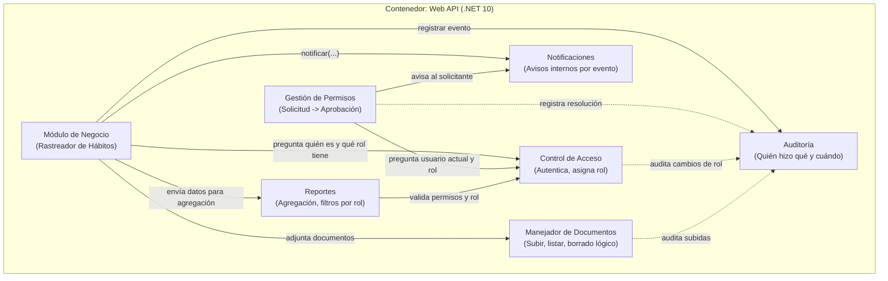

# 🎯 HabitTracker Nexus - Sistema de Gestión de Hábitos

Plataforma de alta fidelidad para el registro de hábitos diarios, organización de metas y trazabilidad del progreso a lo largo del tiempo. Proyecto desarrollado en .NET 10 siguiendo estrictamente los principios de **Clean Architecture** y el patrón de **Monolito Modular**.

## 🏗️ Arquitectura de Componentes (C4 - Nivel 3)

El sistema opera bajo un único contenedor (Web API) dividido en 7 módulos completamente independientes. No existen bases de datos compartidas internamente ni dependencias cíclicas.

> **Nota:** El módulo `DocManager` reflejado en el diagrama corresponde al directorio físico `Modules/DocumentManager`.



## 🚀 Compilación y Ejecución

Para trabajar con este proyecto, asegúrate de tener instalado el SDK de .NET 10 o superior.

```bash
# Compilar la solución entera
dotnet build HabitTrackerSystem.slnx

# Ejecutar la Web API localmente
dotnet run --project Host/WebApi/WebApi.csproj

# Ejecutar toda la suite de pruebas unitarias
dotnet test
```

## Pruebas

Ejecuta toda la suite de pruebas unitarias con:

```bash
dotnet test
```

## Defectos

La siguiente tabla documenta los seis defectos de la Variante A y las pruebas existentes que los detectan. Los nombres corresponden a los métodos actuales de la suite.

| Defecto Tag | Requisito | Archivo y Método / Línea Afectada | Prueba que lo Detecta | Comportamiento Erróneo Producido |
|---|---|---|---|---|
| `practica-2-defecto-1` | RF-GP-06 | Dominio: `Modules/Permissions/Permissions.Domain/Entities/SolicitudPermiso.cs`, método `Aprobar` — reemplazar la validación de transición válida por una comprobación que solo excluya `Rechazada`. | `RF_GP_06_Aprobar_SolicitudAplicadaNoPuedeAprobarseOtraVez` | Permite aprobar otra vez una solicitud ya aplicada y sobrescribe los datos de resolución. |
| `practica-2-defecto-2` | RF-GP-06 | Dominio: `Modules/Permissions/Permissions.Domain/Entities/TransicionesSolicitudPermiso.cs`, método `EsValida` — permitir la transición desde `Rechazada` hacia el flujo de aprobación y aplicación (`Aprobada` → `Aplicada`). | `RF_GP_06_Aprobar_SolicitudRechazadaNoPuedeAprobarse` | Una solicitud rechazada puede ser aprobada y terminar aplicada. |
| `practica-2-defecto-3` | RF-GP-07 | Dominio: `Modules/Permissions/Permissions.Domain/Entities/SolicitudPermiso.cs`, método `Aprobar` — omitir la validación de auto-resolución. | `RF_GP_07_Aprobar_AdminNoPuedeResolverSuPropiaSolicitud` | Un Administrador puede aprobar su propia solicitud. |
| `practica-2-defecto-4` | RF-GP-02 | Infraestructura: `Modules/Permissions/Permissions.Infrastructure/Repositories/SolicitudPermisoRepository.cs`, método `GetBySolicitanteAsync` — invertir el filtro de solicitante. | `RF_GP_02_Consultar_EstandarRecibeTodasSusSolicitudesYNoLasDeOtros` | Un usuario Estándar recibe solicitudes ajenas en lugar de ver únicamente las propias. |
| `practica-2-defecto-5` | RF-GP-06 | Dominio: `Modules/Permissions/Permissions.Domain/Entities/TransicionesSolicitudPermiso.cs`, método `EsValida` — agregar la transición `Aprobada` → `Pendiente`. | `RF_GP_06_Transicion_AprobadaNoPuedeVolverAPendiente` | Una solicitud aprobada puede volver al estado Pendiente. |
| `practica-2-defecto-6` | RF-GP-04 | Dominio: `Modules/Permissions/Permissions.Domain/Entities/SolicitudPermiso.cs`, método `Rechazar` — omitir la asignación de `MotivoRechazo`. | `RF_GP_04_Rechazar_ConMotivoRegistraResolucionYEstadoRechazado` | La solicitud queda rechazada, pero el motivo enviado no se conserva. |

## 🗂️ Modelo de Datos del Negocio (Rastreador de Hábitos)

El módulo de negocio está estructurado sobre 6 entidades que modelan la trazabilidad completa de hábitos, metas y progreso del usuario.

| Entidad | Descripción | Relaciones |
|---|---|---|
| **`Categoria`** | Agrupa hábitos por tipo de actividad (ej. salud, productividad, finanzas). | Tiene muchas `Metas` asociadas. |
| **`Meta`** | Representa un objetivo a alcanzar con un título, estado y fecha límite. | Pertenece a una `Categoria`, contiene `Habitos` y `Recompensas`. |
| **`Habito`** | Define la acción diaria repetible con su nombre y frecuencia de ejecución. | Pertenece a una `Meta`, tiene `RegistrosDiarios` y `Etiquetas`. |
| **`RegistroDiario`** | Registro transaccional del avance del hábito en una fecha específica (completado o no). | Pertenece a un `Habito`. |
| **`Etiqueta`** | Etiqueta descriptiva y visual que clasifica hábitos por características (ej. urgente, preferido). | Asociada a muchos `Habitos`. |
| **`Recompensa`** | Sistema de puntos canjeables por el cumplimiento de metas, incentivando la constancia. | Pertenece a una `Meta`. |

**Flujo de relaciones:** `Categoria` → `Meta` → `Habito` → `RegistroDiario`, con `Etiqueta` y `Recompensa` como referencias transversales a `Habito` y `Meta` respectivamente.

## 💻 Stack Tecnológico

**Framework Principal:** .NET 10 (Web API)

**Lenguaje:** C#

**Arquitectura:** Clean Architecture (Monolito Modular)

**ORM:** Entity Framework Core

**Seguridad:** JWT (JSON Web Tokens) & Hashing (Argon2/BCrypt)

**Testing:** xUnit / Moq

## 🤝 Guía de Colaboración (Workflow del Equipo)

Para garantizar el cumplimiento de los Requisitos de Diseño (RD) del contrato, todos los miembros del equipo deben adherirse a las siguientes directrices:

### 1. Flujo de Control de Versiones (Git Flow)

- Prohibido subir a main directamente. Todo desarrollo ocurre en la rama develop.
- Cada nueva pieza o característica se desarrolla en una rama aislada (ej. `feat/access-control` o `fix/user-login`).
- Los commits deben incluir el identificador del requisito funcional que resuelven (ej. `feat: hashear contraseña en registro [RF-CA-02]`).
- Toda rama debe ser integrada mediante un Pull Request (PR) y revisada por el otro miembro del equipo.

### 2. Reglas de Programación por Módulos

- **Cero código compartido genérico:** Está estrictamente prohibido crear carpetas como `Utils`, `Helpers` o `Common`. Cada módulo guarda lo suyo.
- **Separación de capas:** La lógica de negocio vive obligatoriamente en `Core.Application` o `Core.Domain`. Nunca en los controladores HTTP de la API (RD-02).
- **Fechas:** Todo registro de fecha en el sistema debe generarse utilizando `DateTime.UtcNow` (RD-11).

### 3. Comunicación entre Módulos

- **Prohibido cruzar fronteras de datos:** Un módulo NUNCA debe hacer un SELECT directo a las tablas de otro módulo.
- **Inyección de dependencias:** Si HabitTracker necesita saber quién está logueado, debe inyectar la interfaz expuesta por AccessControl y solicitar la información. La dependencia viaja en un solo sentido.

### 4. Estrategia de Pruebas (Testing)

- **Aislamiento (RD-12):** Cada pieza del Core debe poder probarse sin levantar la aplicación completa.
- Toda máquina de estados (Permisos y Metas) debe contar con pruebas unitarias en xUnit que validen transiciones permitidas y rechacen transiciones prohibidas antes de integrarse con la base de datos.

## Evaluación de Práctica 1 (Control de Acceso y Hábitos)

### Requisitos Previos y Variables de Entorno
Para ejecutar este proyecto, necesitas configurar User Secrets o variables de entorno locales. **Nunca incluyas valores reales en el código fuente.**

*   `ConnectionStrings:AccessControl`: (String) Cadena a SQL Server con autenticación de Windows, sin contraseña en el repo. Ejemplo: `Server=.\SQLEXPRESS;Database=HabitTracker;Trusted_Connection=True;TrustServerCertificate=True` (o `Server=(localdb)\MSSQLLocalDB;...`).
*   `JwtSettings:Clave`: (String) Clave secreta de al menos 32 caracteres para firmar los tokens JWT. Solo vía User Secrets: `dotnet user-secrets set "JwtSettings:Clave" "tu-clave..." --project Host/WebApi/WebApi.csproj`.
*   `JwtSettings:Emisor`: (String) Emisor del token (ej. `HabitTrackerNexus`).
*   `JwtSettings:Audiencia`: (String) Audiencia del token (ej. `HabitTrackerNexusApi`).
*   `JwtSettings:MinutosExpiracion`: (int) Vida del token en minutos (ej. `60`).
*   `SMTP_HOST`, `SMTP_PORT`, `SMTP_USER`, `SMTP_PASS`: (String) Credenciales del servidor de correo saliente, solo por variables de entorno o User Secrets.
*   `App:BaseUrl`: (String) URL pública de la API para armar el enlace de activación del correo (ej. `http://localhost:5246`).

### Instrucciones de Ejecución
1. Restaura las herramientas y paquetes: `dotnet restore`
2. Aplica las migraciones a tu base de datos local (SQL Server):
   `dotnet ef database update --project Modules/AccessControl/AccessControl.Infrastructure --startup-project Host/WebApi --context ApplicationDbContext`
   `dotnet ef database update --project Modules/HabitTracker/HabitTracker.Infrastructure --startup-project Host/WebApi --context HabitTrackerDbContext`
3. Levanta la API:
   `dotnet run --project Host/WebApi/WebApi.csproj`
4. Abre Swagger en `http://localhost:5246/swagger` (usa el botón Authorize con `Bearer {token}`).

### Guía de Pruebas (Criterios de Aceptación)
Sigue estas instrucciones desde Swagger o Postman para validar la rúbrica:

*   **Registro y rechazo controlado:** Usa `POST /api/auth/register` con una clave menor a 8 caracteres o sin números. Recibirás un error 400 controlado.
*   **Encolado de correos (Sin SMTP):** Si el servidor SMTP no está configurado o falla, el registro (201 Created) y la recuperación de clave terminan con éxito. Los correos quedan pendientes en la tabla/cola interna.
*   **Activación y un solo uso:** Tras registrarte, usa el token simulado en `POST /api/auth/activate`. Si lo envías dos veces, la segunda vez será rechazado.
*   **Seguridad de enumeración (Recuperación):** Llama a `POST /api/auth/recuperar-password` con un correo falso y luego con uno registrado. Ambos reciben `200 OK` con el mismo mensaje; el servidor aplica un tiempo mínimo de respuesta para reducir diferencias de temporización.
*   **Bloqueo de fuerza bruta (15 min):** Falla cinco veces seguidas en `POST /api/auth/login`; la cuenta queda bloqueada. El siguiente inicio se rechaza incluso si se usa la contrasena correcta.
*   **Invalidación de sesión (Logout / Cambio de Rol/Clave):** Inicia sesión, guarda el JWT. Llama a `POST /api/auth/logout`. Vuelve a intentar usar el JWT en `GET /api/auth/me`; recibirás un `401 Unauthorized`.
*   **Protección por Roles:** Como usuario Estándar, intenta invocar `GET /api/admin/usuarios` (construyendo la petición manualmente si es necesario). El sistema devolverá `403 Forbidden`.
*   **Desactivación y Autodesactivación:** Como Administrador, intenta desactivarte a ti mismo en `PATCH /api/admin/usuarios/{tu_id}/estado`. El sistema lo rechazará. Desactiva a otro usuario y sus sesiones abiertas morirán instantáneamente.

---
*Documentación de la Máquina de Estados disponible en `docs/maquina-de-estados.md`.*

## Asignación 2 — Gestión de Permisos

Pieza del Core con máquina de estados propia (`Pendiente → Aprobada → Aplicada`, `Pendiente → Rechazada`; cualquier otra transición está prohibida). Capas: `Permissions.Domain` (entidad rica `SolicitudPermiso` + `TransicionesSolicitudPermiso` + `DomainResult`), `Permissions.Application` (`SolicitudPermisoService` con filtro por rol), `Permissions.Infrastructure` (`PermissionsDbContext` propio + `SolicitudPermisoRepository`) y endpoints en `PermissionsController` (`api/permissions`) protegidos con JWT.

### Pruebas

```bash
# Suite completa con un solo comando (17 pruebas, sin levantar la API ni la BD)
dotnet test
```

### Guía de verificación (Swagger o cURL, RF-GP-01 a RF-GP-07)

1. Registra dos usuarios Estándar y activa sus cuentas (`POST /api/auth/register`, `POST /api/auth/activate`).
2. Promueve uno a Administrador en la BD (`UPDATE usuarios SET Rol = 2 WHERE Correo = '...'`) e inicia sesión con ambos para obtener sus JWT.
3. **RF-GP-01:** como Estándar, `POST /api/permissions` con `{"permisoSolicitado":"Acceso reportes"}` → `201` con el `id`.
4. **RF-GP-02:** como Estándar, `GET /api/permissions` → solo ve las suyas; como Administrador → ve todas. Como Estándar, `GET /api/permissions/{id-ajeno}` → `401`.
5. **RF-GP-03/05:** como Administrador, `POST /api/permissions/{id}/approve` → `200`; verifica en BD que el estado quedó `Aplicada`.
6. **RF-GP-06:** repite el approve sobre la misma solicitud → `400`; aprueba un `id` inexistente → `404`.
7. **RF-GP-04:** `POST /api/permissions/{id}/reject` con `{"motivoRechazo":""}` → `400`; con motivo válido → `200`.
8. **RF-GP-07:** crea una solicitud como Administrador e intenta aprobarla él mismo → `400` (auto-resolución prohibida).
