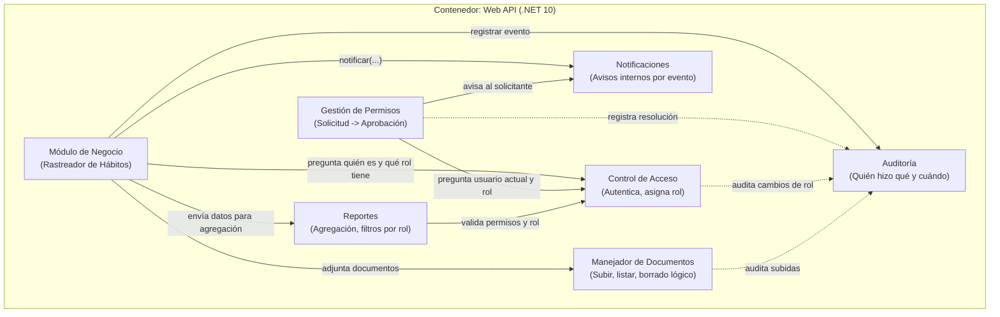

# 🎯 HabitTracker Nexus - Sistema de Gestión de Hábitos

Plataforma de alta fidelidad para el registro de hábitos diarios, organización de metas y trazabilidad del progreso a lo largo del tiempo. Proyecto desarrollado en .NET 10 siguiendo estrictamente los principios de **Clean Architecture** y el patrón de **Monolito Modular**.

## 🏗️ Arquitectura de Componentes (C4 - Nivel 3)

El sistema opera bajo un único contenedor (Web API) dividido en 7 módulos completamente independientes. No existen bases de datos compartidas internamente ni dependencias cíclicas.

> **Nota:** El módulo `DocManager` reflejado en el diagrama corresponde al directorio físico `Modules/DocumentManager`.



## 🚀 Compilación y Ejecución

Para trabajar con este proyecto, asegúrate de tener instalado el SDK de .NET 10 o superior.

```bash
# Compilar la solución entera
dotnet build HabitTrackerSystem.slnx

# Ejecutar la Web API localmente
dotnet run --project Host/WebApi/WebApi.csproj

# Ejecutar toda la suite de pruebas unitarias
dotnet test
```

## Pruebas

Ejecuta toda la suite de pruebas unitarias con:

```bash
dotnet test
```

La suite prueba directamente las capas de aplicación, dominio e infraestructura: no inicia la API ni necesita una base de datos externa. Las pruebas de persistencia usan SQLite en memoria.

> **Nota (Windows):** clona el repositorio en una ruta corta (por ejemplo `C:/src/HabitTracker`). Con rutas de más de 260 caracteres, la DLL nativa de SQLite (`e_sqlite3`) no se carga y las pruebas de persistencia fallan con "The filename or extension is too long".

### Comprobación de la entrega desde un clon limpio

Clona el repositorio y, desde su raíz, compila y verifica primero la etiqueta correcta:

```bash
git clone https://github.com/J-bot-oss-code/HabitTracker-Arquitectura.git
cd HabitTracker-Arquitectura
git fetch origin --tags
git checkout --detach practica-2
dotnet build HabitTrackerSystem.slnx
dotnet test
```

El tag revisado `practica-2` contiene 39 pruebas. Cada tag `practica-2-defecto-N` es un commit hijo directo de esa base y planta un solo defecto en código de producción de Gestión de Permisos. La suite debe pasar completa en `practica-2` y fallar al menos una prueba en cada tag de defecto; esos fallos son intencionales:

```bash
git checkout --detach practica-2-defecto-1
dotnet test
```

Repite el comando para `practica-2-defecto-2` hasta `practica-2-defecto-6` y compara el nombre de la prueba fallida con la tabla `Defectos`. Para verificar la forma del commit de cada mutante:

```bash
git show -s --format="%H %P %s" practica-2-defecto-1
git diff --stat practica-2 practica-2-defecto-1
git diff practica-2 practica-2-defecto-1 -- Modules/Permissions/
```

El único padre mostrado debe ser el commit de `practica-2`. El `--stat` debe listar un solo archivo productivo de Gestión de Permisos y ningún archivo de pruebas; inspecciona el diff para confirmar que contiene únicamente el defecto descrito. Repite las tres comprobaciones para los seis tags.

## Defectos — Práctica 2

La siguiente tabla documenta los seis defectos de la Variante A y las pruebas existentes que los detectan. Los nombres corresponden a los métodos actuales de la suite.

| Defecto Tag | Requisito | Archivo y Método / Línea Afectada | Prueba que lo Detecta | Comportamiento Erróneo Producido |
|---|---|---|---|---|
| `practica-2-defecto-1` | RF-GP-06 | Dominio: `Modules/Permissions/Permissions.Domain/Entities/SolicitudPermiso.cs`, método `Aprobar`, líneas 61 y 66 — reemplazar la validación de transición válida por una comprobación que solo excluya `Rechazada`. | `RF_GP_06_Aprobar_SolicitudAplicadaNoPuedeAprobarseOtraVez` | Permite aprobar otra vez una solicitud ya aplicada y sobrescribe los datos de resolución. |
| `practica-2-defecto-2` | RF-GP-06 | Dominio: `Modules/Permissions/Permissions.Domain/Entities/TransicionesSolicitudPermiso.cs`, método `EsValida` — agregar únicamente la transición directa `Rechazada` → `Aplicada`. | `RF_GP_06_Transicion_RechazadaNoPuedeIrDirectamenteAAplicada` | La máquina de estados acepta una transición prohibida desde Rechazada directamente a Aplicada. |
| `practica-2-defecto-3` | RF-GP-07 | Dominio: `Modules/Permissions/Permissions.Domain/Entities/SolicitudPermiso.cs`, método `Aprobar` — omitir la validación de auto-resolución. | `RF_GP_07_Aprobar_AdminNoPuedeResolverSuPropiaSolicitud` | Un Administrador puede aprobar su propia solicitud. |
| `practica-2-defecto-4` | RF-GP-02 | Infraestructura: `Modules/Permissions/Permissions.Infrastructure/Repositories/SolicitudPermisoRepository.cs`, método `GetBySolicitanteAsync` — invertir el filtro de solicitante. | `RF_GP_02_Repository_FiltraPorSolicitanteYEstadoEnLaBaseDeDatos` | Un usuario Estándar recibe solicitudes ajenas en lugar de ver únicamente las propias. |
| `practica-2-defecto-5` | RF-GP-06 | Dominio: `Modules/Permissions/Permissions.Domain/Entities/TransicionesSolicitudPermiso.cs`, método `EsValida` — agregar la transición `Aprobada` → `Pendiente`. | `RF_GP_06_Transicion_AprobadaNoPuedeVolverAPendiente` | Una solicitud aprobada puede volver al estado Pendiente. |
| `practica-2-defecto-6` | RF-GP-04 | Dominio: `Modules/Permissions/Permissions.Domain/Entities/SolicitudPermiso.cs`, método `Rechazar` — omitir la asignación de `MotivoRechazo`. | `RF_GP_04_Rechazar_ConMotivoRegistraResolucionYEstadoRechazado` | La solicitud queda rechazada, pero el motivo enviado no se conserva. |

## 🗂️ Modelo de Datos del Negocio (Rastreador de Hábitos)

El módulo de negocio está estructurado sobre 6 entidades que modelan la trazabilidad completa de hábitos, metas y progreso del usuario.

| Entidad | Descripción | Relaciones |
|---|---|---|
| **`Categoria`** | Agrupa hábitos por tipo de actividad (ej. salud, productividad, finanzas). | Tiene muchas `Metas` asociadas. |
| **`Meta`** | Representa un objetivo a alcanzar con un título, estado y fecha límite. | Pertenece a una `Categoria`, contiene `Habitos` y `Recompensas`. |
| **`Habito`** | Define la acción diaria repetible con su nombre y frecuencia de ejecución. | Pertenece a una `Meta`, tiene `RegistrosDiarios` y `Etiquetas`. |
| **`RegistroDiario`** | Registro transaccional del avance del hábito en una fecha específica (completado o no). | Pertenece a un `Habito`. |
| **`Etiqueta`** | Etiqueta descriptiva y visual que clasifica hábitos por características (ej. urgente, preferido). | Asociada a muchos `Habitos`. |
| **`Recompensa`** | Sistema de puntos canjeables por el cumplimiento de metas, incentivando la constancia. | Pertenece a una `Meta`. |

**Flujo de relaciones:** `Categoria` → `Meta` → `Habito` → `RegistroDiario`, con `Etiqueta` y `Recompensa` como referencias transversales a `Habito` y `Meta` respectivamente.

## 💻 Stack Tecnológico

**Framework Principal:** .NET 10 (Web API)

**Lenguaje:** C#

**Arquitectura:** Clean Architecture (Monolito Modular)

**ORM:** Entity Framework Core

**Seguridad:** JWT (JSON Web Tokens) & Hashing (Argon2/BCrypt)

**Testing:** xUnit / Moq

## 🤝 Guía de Colaboración (Workflow del Equipo)

Para garantizar el cumplimiento de los Requisitos de Diseño (RD) del contrato, todos los miembros del equipo deben adherirse a las siguientes directrices:

### 1. Flujo de Control de Versiones (Git Flow)

- Prohibido subir a main directamente. Todo desarrollo ocurre en la rama develop.
- Cada nueva pieza o característica se desarrolla en una rama aislada (ej. `feat/access-control` o `fix/user-login`).
- Los commits deben incluir el identificador del requisito funcional que resuelven (ej. `feat: hashear contraseña en registro [RF-CA-02]`).
- Toda rama debe ser integrada mediante un Pull Request (PR) y revisada por el otro miembro del equipo.

### 2. Reglas de Programación por Módulos

- **Cero código compartido genérico:** Está estrictamente prohibido crear carpetas como `Utils`, `Helpers` o `Common`. Cada módulo guarda lo suyo.
- **Separación de capas:** La lógica de negocio vive obligatoriamente en `Core.Application` o `Core.Domain`. Nunca en los controladores HTTP de la API (RD-02).
- **Fechas:** Todo registro de fecha en el sistema debe generarse utilizando `DateTime.UtcNow` (RD-11).

### 3. Comunicación entre Módulos

- **Prohibido cruzar fronteras de datos:** Un módulo NUNCA debe hacer un SELECT directo a las tablas de otro módulo.
- **Inyección de dependencias:** Si HabitTracker necesita saber quién está logueado, debe inyectar la interfaz expuesta por AccessControl y solicitar la información. La dependencia viaja en un solo sentido.

### 4. Estrategia de Pruebas (Testing)

- **Aislamiento (RD-12):** Cada pieza del Core debe poder probarse sin levantar la aplicación completa.
- Toda máquina de estados (Permisos y Metas) debe contar con pruebas unitarias en xUnit que validen transiciones permitidas y rechacen transiciones prohibidas antes de integrarse con la base de datos.

## Evaluación de Práctica 1 (Control de Acceso y Hábitos)

### Requisitos Previos y Variables de Entorno
Para ejecutar este proyecto, necesitas configurar User Secrets o variables de entorno locales. **Nunca incluyas valores reales en el código fuente.**

*   `ConnectionStrings:AccessControl`: (String) Cadena a SQL Server con autenticación de Windows, sin contraseña en el repo. Ejemplo: `Server=.\SQLEXPRESS;Database=HabitTracker;Trusted_Connection=True;TrustServerCertificate=True` (o `Server=(localdb)\MSSQLLocalDB;...`).
*   `JwtSettings:Clave`: (String) Clave secreta de al menos 32 caracteres para firmar los tokens JWT. Solo vía User Secrets: `dotnet user-secrets set "JwtSettings:Clave" "tu-clave..." --project Host/WebApi/WebApi.csproj`.
*   `JwtSettings:Emisor`: (String) Emisor del token (ej. `HabitTrackerNexus`).
*   `JwtSettings:Audiencia`: (String) Audiencia del token (ej. `HabitTrackerNexusApi`).
*   `JwtSettings:MinutosExpiracion`: (int) Vida del token en minutos (ej. `60`).
*   `SMTP_HOST`, `SMTP_PORT`, `SMTP_USER`, `SMTP_PASS`: (String) Credenciales del servidor de correo saliente, solo por variables de entorno o User Secrets.
*   `App:BaseUrl`: (String) URL pública de la API para armar el enlace de activación del correo (ej. `http://localhost:5246`).

### Instrucciones de Ejecución
1. Restaura las herramientas y paquetes: `dotnet restore`
2. Aplica las migraciones a tu base de datos local (SQL Server):
   `dotnet ef database update --project Modules/AccessControl/AccessControl.Infrastructure --startup-project Host/WebApi --context ApplicationDbContext`
   `dotnet ef database update --project Modules/HabitTracker/HabitTracker.Infrastructure --startup-project Host/WebApi --context HabitTrackerDbContext`
   `dotnet ef database update --project Modules/Permissions/Permissions.Infrastructure --startup-project Host/WebApi --context PermissionsDbContext`
3. Levanta la API:
   `dotnet run --project Host/WebApi/WebApi.csproj`
4. Abre Swagger en `http://localhost:5246/swagger` (usa el botón Authorize con `Bearer {token}`).

### Guía de Pruebas (Criterios de Aceptación)
Sigue estas instrucciones desde Swagger o Postman para validar la rúbrica:

Configura `ConnectionStrings:AccessControl`, la clave JWT y aplica las tres migraciones siguiendo las instrucciones anteriores. Ejecuta `dotnet run --project Host/WebApi/WebApi.csproj` y abre `http://localhost:5246/swagger` en el entorno local de desarrollo. En Swagger, usa **Authorize** y pega `Bearer ` seguido del JWT obtenido al iniciar sesión. No compartas ni publiques ese token. Para estas comprobaciones, usa cuentas de prueba con correos distintos y activa cada cuenta antes de iniciar sesión.

* **Inicio de sesión, claims y expiración:** ejecuta `POST /api/auth/login` con las credenciales de una cuenta activa; autoriza Swagger con el JWT recibido y ejecuta `GET /api/auth/me` para comprobar el id, correo y rol autenticados. Inspecciona localmente el payload del JWT y confirma que contiene los datos de identidad y una expiración futura (`exp`). No publiques el JWT. Ejecuta `POST /api/auth/logout`; el mismo token debe quedar invalidado y `GET /api/auth/me` debe responder `401`.
*   **Registro y rechazo controlado:** Usa `POST /api/auth/register` con una clave menor a 8 caracteres o sin números. Recibirás un error 400 controlado.
*   **Encolado de correos (Sin SMTP):** Si el servidor SMTP no está configurado o falla, el registro (201 Created) y la recuperación de clave terminan con éxito. Los correos quedan pendientes en la tabla/cola interna.
*   **Registro y activación por correo:** Envía `POST /api/auth/register` con `{"nombre":"Persona de prueba","correo":"persona@ejemplo.com","password":"ClaveSegura123"}`. El usuario se crea inactivo y se encola el mensaje de activación. Obtén el token del correo o, en desarrollo local sin SMTP, consulta `usuarios.TokenAcceso` o `CorreosEnCola.Cuerpo` en la base AccessControl. Activa la cuenta con `POST /api/auth/activate` y `{"token":"TOKEN_RECIBIDO"}`. La cuenta queda activa; reutilizar el token se rechaza.

    ```sql
    SELECT TokenAcceso, Vencimiento
    FROM usuarios
    WHERE Correo = N'persona@ejemplo.com';
    ```

*   **Inicio y cierre de sesión:** Inicia sesión con `POST /api/auth/login` y `{"email":"persona@ejemplo.com","password":"ClaveSegura123"}`. Guarda el JWT recibido, úsalo como `Authorization: Bearer <JWT>` para `GET /api/auth/me` y luego envíalo en `POST /api/auth/logout`. Repite `GET /api/auth/me` con el mismo token: debe responder `401 Unauthorized`.
*   **Seguridad de enumeración (Recuperación):** Llama a `POST /api/auth/recuperar-password` con un correo falso y luego con uno registrado. Ambos reciben `200 OK` con el mismo mensaje; el servidor aplica un tiempo mínimo de respuesta para reducir diferencias de temporización.
*   **Recuperación de contraseña paso a paso:** Envía `POST /api/auth/forgot-password` con `{"correo":"persona@ejemplo.com"}`. El endpoint responde siempre `200 OK` con un mensaje genérico. Para una cuenta existente, el código de seis caracteres se envía por correo. En un entorno local sin SMTP operativo, consulta la cola de correos de la base `AccessControl`; el cuerpo HTML de `CorreosEnCola` contiene el código:

    ```sql
    SELECT TOP (10) Id, Destinatario, Asunto, Cuerpo, Estado, FechaCreacion
    FROM CorreosEnCola
    WHERE Destinatario = N'persona@ejemplo.com'
    ORDER BY FechaCreacion DESC;
    ```

    Usa el código recibido en `POST /api/auth/reset-password` con `{"correo":"persona@ejemplo.com","codigo":"CODIGO_DE_SEIS_CARACTERES","nuevaPassword":"NuevaClave123"}`. La respuesta exitosa es `200 OK`; el código es de un solo uso y el cambio invalida las sesiones anteriores. Los nombres en español `POST /api/auth/recuperar-password` y `POST /api/auth/restablecer-password` son rutas equivalentes. Trata el código como una credencial temporal: consulta la cola solo en la base local de desarrollo y no copies su contenido a logs o reportes.
*   **Bloqueo de fuerza bruta (15 min):** Falla cinco veces seguidas en `POST /api/auth/login`; la cuenta queda bloqueada. El siguiente inicio se rechaza incluso si se usa la contrasena correcta.
*   **Invalidación de sesión (Logout / Cambio de Rol/Clave):** Inicia sesión, guarda el JWT. Llama a `POST /api/auth/logout`. Vuelve a intentar usar el JWT en `GET /api/auth/me`; recibirás un `401 Unauthorized`.
*   **Protección por Roles:** En la base de datos local de pruebas, promueve una cuenta activada a Administrador (`UPDATE usuarios SET Rol = 2 WHERE Correo = 'admin@ejemplo.com'`; el valor 2 corresponde a `Administrador`). Inicia sesión de nuevo con esa cuenta para obtener un JWT con el rol actualizado. Autoriza Swagger con el JWT de otra cuenta Estándar e invoca `GET /api/admin/usuarios`: debe responder `403 Forbidden`. Autoriza después con el token de Administrador y la misma operación debe responder `200 OK`. No ejecutes la actualización SQL en una base compartida o de producción.
*   **Desactivación y Autodesactivación:** Como Administrador, intenta desactivarte a ti mismo en `PATCH /api/admin/usuarios/{tu_id}/estado`. El sistema lo rechazará. Desactiva a otro usuario y sus sesiones abiertas morirán instantáneamente.

---
*Documentación de la Máquina de Estados disponible en `docs/maquina-de-estados.md`.*

---

## Práctica 3 — Módulo de Negocio (Habit Tracker)

Pieza del Core con máquina de estados propia (`Planificado → Activo → Pausado → Activo → Completado`; `Completado` único terminal). Capas: `HabitTracker.Domain` (entidad rica `Habito` + `TransicionesHabito` + `Periodicidad`), `HabitTracker.Application` (`HabitoService` con 5 casos de uso), `HabitTracker.Infrastructure` (`HabitTrackerDbContext` propio + `HabitoRepository` + `MetaRepository` + `HabitTrackerUnitOfWork`) y endpoints en `HabitsController` (`api/habits`) protegidos con JWT y rol `Estandar`.

### Pruebas

```bash
# Suite completa con un solo comando (106 pruebas, sin levantar la API ni una BD externa)
dotnet test
```

La suite incluye pruebas unitarias de dominio (43), aplicación (21), integración real con Gestión de Permisos (1), persistencia real de avances con EF Core/SQLite (2), Control de Acceso (12) y Gestión de Permisos (27). Las pruebas usan dobles de prueba o componentes en memoria/SQLite; no inician la API ni requieren una base de datos externa.

### Máquina de estados

La entidad central es `Habito`. Exactamente cuatro estados: `Planificado` (inicial), `Activo`, `Pausado` y `Completado` (único terminal). Las transiciones se deciden en un solo punto: `TransicionesHabito.EsTransicionValida`. Detalle completo en `docs/maquina-de-estados.md`.

### Las cinco funcionalidades separables (RF-NEG-02)

Cada operación se puede provocar y verificar por separado. Requieren JWT válido y rol `Estandar`. La identidad y `usuarioActualId` se obtienen de los claims autenticados, nunca del cuerpo de la petición.

| ID | Funcionalidad y ruta | Comportamiento |
|---|---|---|
| RF-NEG-02.1 | Crear hábito — `POST /api/habits` | Crea para el usuario autenticado un hábito con nombre, periodicidad, cantidad objetivo y unidad. Nace en `Planificado`. Requiere `MetaId` válido. |
| RF-NEG-02.2 | Consultar mis hábitos — `GET /api/habits` | Devuelve únicamente hábitos del usuario autenticado. |
| RF-NEG-02.3 | Cambiar estado — `POST /api/habits/{id}/transition` | Acepta solo las transiciones de la tabla y las condiciones de propietario/objetivo. |
| RF-NEG-02.4 | Registrar avance diario — `POST /api/habits/{id}/progress` | Registra una cantidad positiva en la unidad configurada. Solo el propietario y solo si está `Activo`. |
| RF-NEG-02.5 | Reconfigurar/resetear — `POST /api/habits/{id}/advanced-reconfig` | Cambia periodicidad, cantidad objetivo o unidad. Requiere permiso aplicado `Habits.AdvancedReconfig`. |

### Guía de verificación (Swagger o cURL, RF-NEG-02 a RF-NEG-06)

Ejecuta estos pasos con la API y SQL Server local activos, después de aplicar las migraciones descritas arriba. Usa cuentas de prueba distintas y guarda el identificador devuelto al crear cada hábito.

1. Registra un usuario Estándar y activa su cuenta con el flujo de correo descrito en la Práctica 1 (`POST /api/auth/register`, `POST /api/auth/activate`). Para las comprobaciones de rol, promueve una cuenta activada a Administrador únicamente en la base local (`UPDATE usuarios SET Rol = 2 WHERE Correo = 'admin@ejemplo.com'`) y vuelve a iniciar sesión para obtener su JWT actualizado.

2. **RF-NEG-02.1 (Crear):** como Estándar, `POST /api/habits` con `{"nombre":"Leer 20 páginas","periodicidad":"Diaria","cantidadObjetivo":20,"unidad":"páginas","metaId":"<GUID_META_VALIDA>"}` → `201` con el `id`. El hábito nace en `Planificado`.

3. **RF-NEG-02.2 (Consultar):** como el mismo Estándar, `GET /api/habits` → solo ve sus hábitos. Como otro Estándar, `GET /api/habits` → no ve los hábitos del primero.

4. **RF-NEG-02.3 (Cambiar estado):** con el hábito recién creado (`Planificado`), `POST /api/habits/{id}/transition` con `{"nuevoEstado":"Completado"}` → `400` (no se salta `Activo`). Luego `{"nuevoEstado":"Activo"}` → `204`, `Pausado` → `204`; estando `Pausado`, `Completado` → `400`; vuelve a `Activo` → `204`. Los estados se envían como texto (`Planificado`, `Activo`, `Pausado`, `Completado`) o como número (0–3).

5. **RF-NEG-02.4 (Registrar avance):** con el hábito en `Activo`, `POST /api/habits/{id}/progress` con `{"cantidad":5,"fechaUtc":"<FECHA_UTC_ACTUAL>"}` (por ejemplo `2026-10-28T15:00:00Z`) → `204`. Registrar avance con hábito `Pausado` → `400`. Registrar con cantidad 0 → `400`. Solo cuentan para la meta los avances del período vigente (día UTC para `Diaria`, semana ISO para `Semanal`) registrados desde el inicio del ciclo.

6. **RF-NEG-02.5 (Reconfigurar):**
   - Crear una solicitud de permiso: `POST /api/permissions` con `{"permisoSolicitado":"Habits.AdvancedReconfig"}` → `201`.
   - Antes de aprobar, `POST /api/habits/{id}/advanced-reconfig` con `{"periodicidad":"Semanal","cantidadObjetivo":30,"unidad":"minutos"}` → `403`.
   - Como Administrador, `POST /api/permissions/{solicitudId}/approve` → `200` (queda `Aplicada`).
   - Reintentar la reconfiguración con el JWT del solicitante → `204`. El hábito conserva su estado y su historial de avances; los avances anteriores no cuentan para la nueva meta.

7. **Propiedad:** intentar cambiar estado, registrar avance o reconfigurar un hábito de otro usuario → `403`.

8. **Rechazo a no propietario en Planificado → Activo:** crear un hábito con usuario A, intentar activarlo con usuario B → `403`.

9. **Condición de meta para Completado:** crear hábito con meta de 10 unidades, registrar 5 con la fecha UTC actual, intentar completar → `400`. Registrar 5 más el mismo día UTC, completar → `204`.

10. **Estado terminal:** completar un hábito, intentar cualquier transición → `400`. `advanced-reconfig` sobre un hábito `Completado` también → `400`.

### Verificación de persistencia después de reiniciar la API

1. Como usuario Estándar, crea un hábito y registra avance. Guarda el `id`.
2. Detén la API con `Ctrl+C`. Deja SQL Server activo.
3. Inicia de nuevo la API y consulta `GET /api/habits` con el JWT del usuario. El hábito y sus avances deben persistir.

### Comprobación de la entrega desde un clon limpio

```bash
git clone https://github.com/J-bot-oss-code/HabitTracker-Arquitectura.git
cd HabitTracker-Arquitectura
git fetch origin --tags
git checkout --detach practica-3
dotnet build HabitTrackerSystem.slnx
dotnet test
```

El tag revisado `practica-3` contiene 106 pruebas. Cada tag `practica-3-defecto-N` es un commit hijo directo de esa base y planta un solo defecto en código de producción de Habit Tracker. La suite debe pasar completa en `practica-3` y fallar al menos una prueba en cada tag de defecto.

```bash
git checkout --detach practica-3-defecto-1
dotnet test
```

Repite para `practica-3-defecto-2` a `practica-3-defecto-4`. Para verificar la forma del commit de cada mutante:

```bash
git show -s --format="%H %P %s" practica-3-defecto-1
git diff --stat practica-3 practica-3-defecto-1
```

El único padre mostrado debe ser el commit de `practica-3`. El `--stat` debe listar un solo archivo productivo y ningún archivo de pruebas.

## Defectos — Práctica 3

La siguiente tabla documenta los cuatro defectos de la Práctica 3 y las pruebas existentes que los detectan. Los nombres corresponden a los métodos actuales de la suite.

| Defecto Tag | Requisito | Archivo y Línea Afectada | Prueba que lo Detecta | Comportamiento Erróneo Producido |
|---|---|---|---|---|
| `practica-3-defecto-1` | RF-NEG-04 | Dominio: `Modules/HabitTracker/HabitTracker.Domain/Entities/TransicionesHabito.cs`, línea 14 (rama `Planificado → Completado`; resultado en la línea 15) — cambiar el rechazo de `Planificado → Completado` por `true`, permitiendo saltar `Activo`. | `RF_NEG_04_Transicion_PlanificadoACompletado_Rechazada_YPermanecePlanificado` | Permite crear un hábito y completarlo sin pasar por `Activo`. |
| `practica-3-defecto-2` | RF-NEG-05 | Dominio: `Modules/HabitTracker/HabitTracker.Domain/Entities/TransicionesHabito.cs`, línea 18 — agregar la transición `Completado → Activo`. | `RF_NEG_05_Transicion_CompletadoAOtra_Rechazada_EstadoTerminal` | Un hábito completado puede volver a `Activo`, violando el estado terminal. |
| `practica-3-defecto-3` | RF-NEG-04, RD-06 | Dominio: `Modules/HabitTracker/HabitTracker.Domain/Entities/Habito.cs`, línea 79 — omitir `ValidarPropietario` en `Activar()`. | `RF_NEG_04_Activar_NoPropietario_Rechaza` | Un usuario distinto del propietario puede activar el hábito (IDOR). |
| `practica-3-defecto-4` | RF-NEG-06 | Aplicación: `Modules/HabitTracker/HabitTracker.Application/Services/HabitoService.cs`, líneas 149–156 — omitir la consulta a `TienePermisoEfectivoAsync` en `ReconfigurarHabitoAsync`. | `RF_NEG_06_AdvancedReconfig_RechazaSinPermisoYPermiteTrasAprobacion` | La reconfiguración se ejecuta sin verificar el permiso `Habits.AdvancedReconfig`. |

## Revisión acumulada (Práctica 3)

Siguiendo el README desde el tag `practica-3`, comprobar los cinco frentes que pide el PDF:

1. Registro con activación por correo.
2. Inicio y cierre de sesión.
3. Rechazo a un usuario Estándar que invoca una operación de Administrador.
4. Recuperación de contraseña.
5. Gestión de Permisos: crear, aprobar y rechazar solicitudes, y rechazar transiciones fuera de tabla.

Además, verificar Habit Tracker:
- Crear hábito, consultar, cambiar estado, registrar avance, reconfigurar con permiso.

## Asignación 2 — Gestión de Permisos

Pieza del Core con máquina de estados propia (`Pendiente → Aprobada → Aplicada`, `Pendiente → Rechazada`; cualquier otra transición está prohibida). Capas: `Permissions.Domain` (entidad rica `SolicitudPermiso` + `TransicionesSolicitudPermiso` + `DomainResult`), `Permissions.Application` (`SolicitudPermisoService` con filtro por rol), `Permissions.Infrastructure` (`PermissionsDbContext` propio + `SolicitudPermisoRepository`) y endpoints en `PermissionsController` (`api/permissions`) protegidos con JWT.

### Pruebas

```bash
# Suite completa con un solo comando (39 pruebas, sin levantar la API ni una BD externa)
dotnet test
```

La suite incluye pruebas unitarias de los cuatro frentes de Control de Acceso (registro/activación, JWT, autorización por rol y recuperación) y de Gestión de Permisos. Las pruebas usan dobles de prueba o componentes en memoria; no inician la API ni requieren una base de datos externa.

### Guía de verificación (Swagger o cURL, RF-GP-01 a RF-GP-07)

Ejecuta estos pasos con la API y SQL Server local activos, después de aplicar las migraciones descritas arriba. Usa cuentas de prueba distintas y guarda el identificador devuelto al crear cada solicitud.

1. Registra dos usuarios Estándar y activa sus cuentas con el flujo de correo descrito arriba (`POST /api/auth/register`, `POST /api/auth/activate`). Para las comprobaciones de rol, promueve una cuenta activada a Administrador únicamente en la base local (`UPDATE usuarios SET Rol = 2 WHERE Correo = 'admin@ejemplo.com'`) y vuelve a iniciar sesión para obtener su JWT actualizado.
2. **RF-GP-01:** como Estándar, `POST /api/permissions` con `{"permisoSolicitado":"Acceso reportes"}` → `201` con el `id`. Conserva ese id y consulta `GET /api/permissions/{id}`; confirma que el estado inicial sea `Pendiente`.
3. **RF-GP-02:** como cada Estándar, `GET /api/permissions?soloPendientes=false` → solo ve sus solicitudes. Como Administrador, `GET /api/permissions` muestra las pendientes; `GET /api/permissions?soloPendientes=false` muestra todas. Como Estándar, `GET /api/permissions/{id-ajeno}` → `403`.
4. **RF-GP-03:** como Administrador, `POST /api/permissions/{id}/approve` → `200`; la solicitud pasa automáticamente a `Aplicada`. Consulta `GET /api/permissions/{id}` como Administrador y confirma `Aprobador` y `FechaResolucion`.
5. **RF-GP-05 — acción protegida:** solicita el permiso `Consultar mi historial de permisos`. Antes de aprobar, como titular, `GET /api/permissions/actions/Consultar%20mi%20historial%20de%20permisos/execute` → `403`. Como Administrador, aprueba la solicitud. Repite la llamada con el JWT del solicitante → `200` con su historial persistido, incluida la solicitud aplicada. Otro usuario sin el permiso aplicado recibe `403`; un usuario con el permiso solo obtiene su propio historial. No se modifica el rol ni se asigna el permiso manualmente.
6. **RF-GP-04:** usa otra solicitud. Como Administrador, `POST /api/permissions/{id}/reject` con `{"motivoRechazo":""}` → `400`; consulta el detalle y confirma que sigue `Pendiente`. Repite con `{"motivoRechazo":"No cumple la política"}` → `200`; consulta el detalle y confirma el estado `Rechazada` y el motivo exacto.
7. **RF-GP-06:** repite `approve` sobre una solicitud `Aplicada` → `400`; confirma que estado, aprobador y fecha no cambiaron. Intenta `approve` sobre una solicitud `Rechazada` → `400` y confirma que permanece `Rechazada`. Consulta un id inexistente → `404`. Las transiciones directas `Rechazada → Aplicada` y `Aprobada → Pendiente` no tienen endpoint público: se comprueban con las pruebas de dominio y sus tags de defecto.
8. **RF-GP-07:** crea una solicitud usando una cuenta Administrador y, conservando ese mismo token, intenta aprobarla y rechazarla → ambas operaciones responden `400`; la solicitud conserva estado `Pendiente`.

Las rutas de aprobación y rechazo requieren rol Administrador; invocarlas con JWT Estándar debe responder `403`. Al terminar, repite `GET /api/permissions` como cada usuario para confirmar que cada Estándar solo obtiene sus propias solicitudes.

### Verificación de persistencia después de reiniciar la API

1. Como usuario Estándar, crea una solicitud y guarda el `id` devuelto. También puedes aprobarla o rechazarla para comprobar que se conserva su resolución.
2. Detén la API con `Ctrl+C` en la terminal donde ejecutaste `dotnet run --project Host/WebApi/WebApi.csproj`. Deja SQL Server activo y no borres ni recrees la base de datos.
3. Inicia de nuevo la API con `dotnet run --project Host/WebApi/WebApi.csproj` y abre `http://localhost:5246/swagger`.
4. Autoriza Swagger con el JWT de Administrador y consulta `GET /api/permissions/{id}` usando el identificador guardado. Debe aparecer la misma solicitud con su estado; si fue aprobada, también deben conservarse `Aprobador` y `FechaResolucion`, y si fue rechazada, `Aprobador`, `FechaResolucion` y `MotivoRechazo`.

La prueba reinicia el proceso de la API sin reiniciar ni limpiar la base de datos. Así se comprueba que la solicitud y sus datos de resolución permanecen en el almacenamiento SQL configurado.
