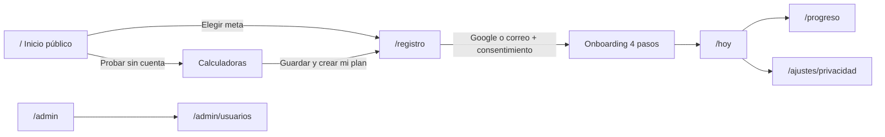

# HabitTracker Nexus — Especificación de diseño (web y móvil)

> Versión: 2026-10-30 · Fuente: canvas de Claude Design "HabitTracker Nexus — Web y móvil"
> Uso: referencia visual y funcional para el agente de frontend (`frontend-ui-builder`, `frontend-design-critic`, `frontend-architect`). Describe pantallas, tokens y componentes; no es código final.
> Requisitos funcionales relacionados: [`mejoras-y-funcionalidades.md`](./mejoras-y-funcionalidades.md)
> **Los números que aparecen en las pantallas son datos de ejemplo.**

## Índice

1. [Principios](#1-principios)
2. [Tokens de diseño](#2-tokens-de-diseño)
3. [Componentes base](#3-componentes-base)
4. [Mapa de pantallas y rutas](#4-mapa-de-pantallas-y-rutas)
5. [Pantallas web](#5-pantallas-web)
6. [Pantallas móviles](#6-pantallas-móviles)
7. [Accesibilidad y responsive](#7-accesibilidad-y-responsive)
8. [Checklist para el agente](#8-checklist-para-el-agente)

---

## 1. Principios

- **Continuidad con la app actual**: mismo logo (cuadro índigo con check), wordmark "HabitTracker **Nexus**", fondo gris claro y tarjetas blancas con borde sutil.
- **"Hoy" es el centro**: después de iniciar sesión, el usuario aterriza en sus tareas del día.
- **Explorar sin cuenta, comprometerse con cuenta**: lo público invita; elegir un plan pide registro.
- **Privacidad visible**: mensajes como "Solo tú las ves" y un Centro de privacidad de primera clase.
- **Sin trucos visuales**: nada de degradados, emoji ni sombras pesadas; un solo color de acento.

## 2. Tokens de diseño

Sugerencia: definirlos como variables CSS en `:root` (por ejemplo `frontend/src/styles/tokens.css`) y reutilizarlos en móvil.

### 2.1 Colores

| Token | Valor | Uso |
| --- | --- | --- |
| `--color-bg` | `#F7F8FB` | Fondo de página |
| `--color-surface` | `#FFFFFF` | Tarjetas, header, inputs |
| `--color-surface-muted` | `#F8FAFC` | Filas completadas, cajas secundarias |
| `--color-border` | `#E2E8F0` | Bordes de tarjetas y separadores |
| `--color-border-strong` | `#CBD5E1` | Bordes de inputs y botones secundarios |
| `--color-text` | `#0F172A` | Texto principal |
| `--color-text-secondary` | `#334155` | Navegación, texto de apoyo fuerte |
| `--color-text-muted` | `#475569` | Texto secundario (cumple 4.5:1 sobre blanco) |
| `--color-icon-muted` | `#94A3B8` | Bordes de checkbox vacío, chevrons |
| `--color-accent` | `#4F46E5` | Botón primario, progreso, estado activo |
| `--color-accent-strong` | `#3730A3` | Texto sobre fondo de acento suave, links hover |
| `--color-accent-soft` | `#EEF2FF` | Fondo de nav activa, chips seleccionados |
| `--color-accent-tint` | `#E0E7FF` | Avatar, texto sobre fondo oscuro |
| `--color-accent-light` | `#A5B4FC` | Días parciales en calendario, iconos sobre oscuro |
| `--color-ink-dark` | `#1E1B4B` | Paneles oscuros (registro, próximo entrenamiento, móvil bienvenida) |
| `--color-streak-bg` / `--color-streak-text` | `#FEF3C7` / `#B45309` | Insignia de racha |
| `--color-info-bg` / `--color-info-border` / `--color-info-text` | `#FFFBEB` / `#FDE68A` / `#78350F` | Aviso de revisión semanal |
| `--color-success-bg` / `--color-success-text` | `#D1FAE5` / `#047857` | Récord personal, variación positiva |
| `--color-danger` | `#B91C1C` | Eliminar cuenta |
| `--color-danger-border` | `#FECACA` | Tarjeta de zona de riesgo |

Calendario de constancia (4 niveles): `#E2E8F0` (nada) → `#C7D2FE` → `#818CF8` → `#4F46E5` (todo hecho).

### 2.2 Tipografía

| Rol | Fuente | Tamaño / peso |
| --- | --- | --- |
| Display (H1 landing) | Plus Jakarta Sans | 52px / 800, line-height 1.08, letter-spacing −0.02em |
| H1 de pantalla | Plus Jakarta Sans | 30–34px / 800 |
| H2 de sección | Plus Jakarta Sans o Inter | 28–32px / 700 (landing), 17–20px / 700 (tarjetas) |
| Cifra KPI | Plus Jakarta Sans | 28–30px / 800 |
| Cuerpo | Inter | 15–16px / 400, line-height 1.55–1.6 |
| Secundario | Inter | 13–14px / 400–600 |
| Etiqueta de categoría | Inter | 12px / 700, mayúsculas, letter-spacing 0.06em |

Google Fonts: `Inter:wght@400;500;600;700` y `Plus Jakarta Sans:wght@600;700;800`.

### 2.3 Espaciado, radios y sombras

- Escala de espaciado: 4, 8, 12, 16, 20, 24, 32, 40, 48, 64 px.
- Contenedor web: `max-width: 1200px` (admin 1280px), padding lateral 24px.
- Radios: inputs y botones 10–12px · tarjetas 16px · tarjetas destacadas 20px · chips 999px.
- Sombra: solo en la tarjeta de ejemplo del hero (`0 12px 32px rgba(15,23,42,0.08)`); el resto usa borde.
- Objetivo táctil mínimo: 44×44px (botones móviles 48–52px de alto).

## 3. Componentes base

| Componente | Descripción | Variantes / estados |
| --- | --- | --- |
| `AppHeader` | Logo + navegación principal + acciones (notificaciones, avatar) | Público (Iniciar sesión / Crear cuenta), usuario, admin (insignia "Admin", correo, "MFA activo") |
| `NavLink` | Enlace de navegación | Activo: fondo `accent-soft`, texto `accent-strong`, `aria-current="page"` |
| `Button` | Botón | Primario (acento), Secundario (blanco con borde), Peligro (rojo), Google (blanco con logo) |
| `Card` | Superficie blanca, borde, radio 16px, padding 20–24px | Normal, oscura (`ink-dark`), aviso (info), riesgo (borde rojo) |
| `StatCard` | Etiqueta + cifra grande + detalle | Con barra de progreso opcional |
| `ProgressBar` | Barra de 6–8px, radio completo | — |
| `ProgressRing` | Anillo SVG con "4/6" en el centro (móvil) | — |
| `TaskRow` | Checkbox + nombre + área · horario + valor | Pendiente (botón checkbox vacío), Hecha (check índigo, texto apagado) |
| `StreakBadge` | Píldora ámbar "12 días de racha" | — |
| `GoalCard` | Área, nivel, nombre, descripción, duración, "Ver plan" | — |
| `FilterChip` | Píldora de filtro | Seleccionado / no seleccionado |
| `WeekStrip` | 7 celdas L–D | Completo, parcial, futuro (borde punteado) |
| `HeatmapCalendar` | Rejilla de días con 4 niveles de intensidad | — |
| `LineChart` | Peso real vs. línea del plan (discontinua) | — |
| `SegmentedControl` | Selector de periodo (4 semanas / 3 meses / Todo) | `aria-pressed` en el activo |
| `Switch` | Interruptor de consentimiento | `role="switch"` + `aria-checked` |
| `SettingsList` | Lista agrupada con valor y chevron (móvil) | — |
| `SetTable` | Tabla de series: serie, anterior, kg, reps, hecha | Fila actual resaltada |
| `RestTimer` | Barra de descanso + botón "+30 s" | — |
| `BottomTabBar` | 5 pestañas móviles: Hoy, Plan, Entrenar, Progreso, Perfil | Activa en acento |
| `ConsentFieldset` | Casillas separadas: términos + salud (obligatoria), privacidad (obligatoria), marketing (opcional) | Ninguna marcada por defecto |

## 4. Mapa de pantallas y rutas

Rutas sugeridas para React Router (ajustar a las existentes).

| Pantalla | Ruta web | Acceso | Artboard |
| --- | --- | --- | --- |
| Inicio público | `/` | Público | Web · Inicio público |
| Catálogo de metas | `/metas` (sección `#metas` en la landing) | Público | Web · Inicio público |
| Calculadoras | `/calculadoras` | Público | Web · Inicio público |
| Registro | `/registro?meta=primeros-5-km` | Público | Web · Registro |
| Iniciar sesión | `/login` | Público | (mismo patrón que Registro) |
| Panel Hoy | `/hoy` | Usuario | Web · Panel Hoy |
| Progreso | `/progreso` | Usuario | Web · Progreso |
| Privacidad y datos | `/ajustes/privacidad` | Usuario | Web · Centro de privacidad |
| Admin · Resumen | `/admin` | Administrador | Web · Panel de administración |
| Admin · Usuarios | `/admin/usuarios` | Administrador | Ya existe |

## 5. Pantallas web

Ancho de referencia: 1280px. Todas son fluidas y se apilan en móvil.

### 5.1 Inicio público (sin sesión) — `/`

1. **Header**: logo · nav (Metas, Ejercicios, Calculadoras, Cómo funciona) · "Iniciar sesión" (texto) + "Crear cuenta" (primario).
2. **Hero** (2 columnas):
   - Izquierda: chip "Para deportistas, gimnasio y cualquiera que quiera mejorar"; H1 "Convierte tu meta en un plan diario que sí puedes cumplir."; párrafo; botones "Elegir mi meta" (primario) y "Probar sin cuenta" (secundario); línea de confianza "Gratis · Entra con Google en un clic · Descarga o borra tus datos cuando quieras".
   - Derecha: tarjeta de ejemplo del panel Hoy (semana 3 de 8 · Primeros 5 km, racha de 12 días, barra 4/6, cuatro filas de tareas).
3. **Elige una meta**: título + subtítulo "Explora los planes libremente. Para empezar uno, crea tu cuenta."; chips de filtro (Todas, Físico, Nutrición, Descanso, Mente); rejilla `auto-fit minmax(260px, 1fr)` de `GoalCard`:
   - Primeros 5 km · Físico · Principiante · 8 semanas · 3 días
   - Ganar masa muscular · Físico · Intermedio · 12 semanas · 4 días
   - Perder grasa de forma sostenible · Nutrición · Todos · 12 semanas · diario
   - Fuerza en casa · Físico · Principiante · 6 semanas · 3 días
   - Dormir mejor · Descanso · Todos · 4 semanas · diario
   - Reducir el estrés · Mente · Todos · 21 días · diario
4. **Calculadora de calorías** (pública, sin guardar): campos Edad, Sexo, Altura (cm), Peso (kg), Actividad; botón "Calcular"; panel de resultado con `[KCAL] kcal / día`, aviso "Es una estimación, no una indicación médica…" y enlace "Guardar y crear mi plan →".
5. **Cómo funciona**: 01 Elige tu meta · 02 Sigue tu plan diario · 03 Mide tu avance.
6. **Banda oscura "Tus datos son tuyos"**: Descarga todo · Borra tu cuenta · Tú decides.
7. **Footer**: © 2026 · Términos de uso · Política de privacidad · Cookies · Aviso de salud.

### 5.2 Registro con Google y términos — `/registro`

Layout de 2 columnas (se apila en móvil).

- **Panel izquierdo oscuro** (`ink-dark`): logo; "Meta elegida" + H1 "Primeros 5 km"; resumen "8 semanas · 3 salidas por semana · nivel principiante…"; 3 beneficios con check; enlace "← Volver a explorar metas".
- **Formulario** (máx. 440px):
  - "Paso 1 de 5" · H2 "Crea tu cuenta" · "¿Ya tienes una? Inicia sesión".
  - Botón **Continuar con Google** (blanco, logo de Google, 48px de alto).
  - Separador "o con tu correo".
  - Campos Nombre, Correo electrónico, Contraseña (ayuda: "Mínimo 12 caracteres… revisamos que no aparezca en filtraciones conocidas").
  - `ConsentFieldset` con 3 casillas sin marcar: Términos + Aviso de salud (obligatorio); Política de privacidad y tratamiento de datos de salud (obligatorio); correos con consejos (opcional).
  - Botón primario "Crear cuenta y continuar".
  - Nota: "Te enviaremos un correo para verificar tu cuenta. Puedes eliminarla en cualquier momento desde tu perfil."
- **Comportamiento**: la meta elegida viaja en la URL y se conserva; con Google también se muestran las casillas obligatorias antes de crear la cuenta; los pasos 2–5 son verificación y onboarding.

### 5.3 Panel Hoy (usuario estándar) — `/hoy`

- **Header de usuario**: nav Hoy (activa), Mi plan, Entrenar, Progreso, Retos; botón de notificaciones; avatar "AE".
- **Encabezado**: "Viernes, 30 de octubre" · H1 "Buenas noches, Ana" · acciones "Registrar peso" (secundario) e "Iniciar entrenamiento" (primario).
- **4 StatCards**: Tareas de hoy 4/6 con barra · Racha actual 12 días (récord 19 · 1 día de gracia) · Cumplimiento semanal 82 % · Plan Semana 3 de 8 (Primeros 5 km · en tiempo).
- **Columna principal — "Tus tareas de hoy"** (+ Añadir hábito), `TaskRow`:
  - Hecha: Trotar 25 min a ritmo suave (Físico · Plan 7:00)
  - Hecha: Estiramientos (Físico · 10 min)
  - Hecha: Desayuno con proteína (Nutrición · hábito diario)
  - Hecha: Caminar 8.000 pasos (8.420)
  - Pendiente: Beber agua (5 / 8 vasos)
  - Pendiente: Dormir 7 horas (recordatorio 22:30)
- **Columna lateral**: tarjeta oscura "Próximo entrenamiento · Mañana · Intervalos" con "Ver sesión"; `WeekStrip` "Esta semana" (oscuro = completo, claro = parcial); aviso "Tu revisión semanal llega el domingo".

### 5.4 Progreso — `/progreso`

- Header con "Progreso" activo.
- H1 "Tu progreso" + `SegmentedControl` (4 semanas / 3 meses / Todo) + "Exportar PDF".
- **Peso**: "82,0 kg → 78,6 kg en 10 semanas"; `LineChart` con leyenda Real (línea índigo) y Plan (discontinua gris).
- **Medidas** (tabla Zona · Inicio · Hoy): Cintura 94→89 cm · Pecho 102→101 cm · Brazo 34→34,5 cm · % grasa 24→21 %; "+ Nueva medición".
- **Fotos de progreso**: candado "Solo tú las ves"; dos marcadores `[FOTO]` (1 de agosto / 30 de octubre); "Comparar antes y después".
- **Récords y logros**: 5 km más rápido 31:40 · Sentadilla 70 kg × 5 · Racha más larga 19 días; insignias "Primera semana completa", "25 entrenamientos", "Meta cumplida · bloqueado".

### 5.5 Centro de privacidad — `/ajustes/privacidad`

- Header simple con "← Volver a Hoy".
- **Menú lateral de ajustes**: Perfil y datos físicos · Seguridad e inicio de sesión · Notificaciones · Privacidad y datos (activo).
- **Descargar mis datos**: explicación del ZIP + botón "Solicitar descarga".
- **Consentimientos** (`Switch`):
  - Usar mis datos de salud para generar el plan — activado (necesario para el servicio).
  - Correos con consejos y novedades — desactivado.
  - Compartir mi cumplimiento con un compañero — activado ("nunca tu peso ni tus fotos").
  - Estadísticas de uso anónimas — activado.
  - Pie: "Aceptaste los Términos v2.1 y la Política de privacidad v1.4 el 1 de agosto de 2026. Ver versiones".
- **Cuentas vinculadas y sesiones**: Google (Desvincular) · "2 sesiones activas · Chrome en Windows (esta), Android" (Cerrar las demás).
- **Retirarme de la plataforma** (borde rojo): explicación de Desactivar vs. Eliminar (borrado definitivo tras 30 días) + botones "Desactivar" (secundario) y "Eliminar mi cuenta" (peligro). Eliminar pide confirmación con contraseña o Google.

### 5.6 Panel de administración — `/admin`

- **Header admin**: insignia "Admin", "admin@demo.com · Administrador · MFA activo", "Cerrar sesión".
- **Menú lateral** (amplía el actual y quita los "PRONTO"):
  - Resumen (activo) · Usuarios · Solicitudes
  - *Contenido*: Planes y metas · Biblioteca de ejercicios · Retos · Documentos legales
  - *Operación*: Notificaciones · Cola de correos · Reportes · Auditoría
- **Encabezado**: H1 "Resumen" · "Métricas agregadas y anónimas" · "Exportar CSV".
- **4 KPIs**: Usuarios activos (30 días) · Registros (7 días, % con Google) · Retención a 30 días · Eliminaciones en curso (en periodo de gracia).
- **Planes más iniciados**: barras horizontales por plan.
- **Auditoría reciente** (tabla con scroll horizontal): Cuándo · Quién · Acción · Origen. Ejemplos: cambió rol, inicio de sesión con Google, solicitó descarga de datos, forzó restablecimiento, solicitó eliminar cuenta.
- **Cola de correos y notificaciones**: "412 enviados hoy · 2 en reintento · 0 fallidos definitivos" + "Abrir cola".

## 6. Pantallas móviles

Tamaño de referencia: 390×844 (iPhone 14 / Android medio). Navegación con `BottomTabBar` de 5 pestañas: **Hoy · Plan · Entrenar · Progreso · Perfil**.

### 6.1 Bienvenida e inicio de sesión

- Fondo `ink-dark`; logo arriba.
- Tarjeta translúcida de ejemplo: semana 3 de 8, racha de 12 días, barra y tira de 7 días.
- H1 "Tu meta, un día a la vez." + párrafo.
- Botones (52px): **Continuar con Google** (blanco), Continuar con Apple, Usar mi correo; enlace "Explorar sin cuenta".
- Pie legal: "Al continuar aceptas los Términos y la Política de privacidad."

### 6.2 Hoy

- "Viernes, 30 oct" · H1 "Hola, Ana" · botón de notificaciones.
- Tarjeta con `ProgressRing` 4/6 · "Vas muy bien hoy" · "Primeros 5 km · semana 3 de 8" · `StreakBadge`.
- Lista "Tareas" (+ Añadir):
  - Hecha: Trotar 25 min (hecho a las 7:12)
  - Hecha: Estiramientos (10 min)
  - Hecha: Desayuno con proteína
  - Hecha: Caminar 8.000 pasos (8.420 desde el reloj)
  - Pendiente: Beber agua (5 de 8 vasos)
  - Pendiente: Dormir 7 horas (recordatorio 22:30)
- `BottomTabBar` con "Hoy" activo.

### 6.3 Sesión de entrenamiento

- Cabecera oscura: minimizar · "Ejercicio 2 de 5" · cronómetro 24:15; H1 "Fuerza A · Piernas"; barra segmentada de 5 ejercicios.
- Tarjeta del ejercicio: miniatura `[VIDEO]`, "Sentadilla · Cuádriceps y glúteos · barra", "Ver técnica".
- `SetTable`: series 1–3 hechas (60×8, 67,5×6, 72,5×5); serie 4 actual resaltada.
- Insignia verde "Nuevo récord personal: 72,5 kg × 5".
- `RestTimer` 1:12 / 2:00 con "+30 s".
- "Siguiente: Prensa de piernas · 3 × 12".
- Barra inferior fija: "Terminar" (secundario) y "Completar serie 4" (primario).

### 6.4 Progreso

- H1 "Progreso" + "Compartir"; `SegmentedControl` Semana / 3 meses / Año.
- Tarjeta de peso: 78,6 kg, −3,4 kg en verde, mini `LineChart` con línea del plan.
- 3 mini KPIs: 12 días de racha · 27 entrenamientos · 82 % cumplimiento.
- `HeatmapCalendar` de octubre (10 columnas, 4 niveles).
- `BottomTabBar` con "Progreso" activo.

### 6.5 Perfil y privacidad

- Avatar "AE" · "Ana Estándar" · "Conectada con Google · desde agosto 2026".
- `SettingsList` agrupada:
  - **Mi cuenta**: Datos físicos (78,6 kg · 175 cm) · Meta activa (Primeros 5 km) · Relojes y salud (Health Connect)
  - **Seguridad**: Desbloqueo con huella (Activado) · Sesiones activas (2) · Notificaciones (5 activas)
  - **Privacidad y datos**: Descargar mis datos · Consentimientos (3 de 4) · Términos y privacidad (v2.1)
- Botón "Eliminar mi cuenta" (borde rojo) — requisito de las tiendas de apps.
- `BottomTabBar` con "Perfil" activo.

## 7. Accesibilidad y responsive

- Contraste de texto ≥ 4.5:1; el gris secundario es `#475569` (no usar grises más claros para texto).
- Elementos interactivos reales: `<button>`, `<a href>`, `<input>` con `<label>`; nunca `onClick` en `div`.
- `aria-label` en botones solo con icono (notificaciones, avatar, marcar tarea).
- `aria-current="page"` en la navegación activa; `aria-pressed` en el selector de periodo; `role="switch"` + `aria-checked` en consentimientos.
- Gráficas SVG con `role="img"` y `aria-label` que diga la conclusión; iconos decorativos con `aria-hidden="true"`.
- Foco visible en todos los controles; objetivos táctiles ≥ 44px.
- **Responsive web**: layouts con `flex-wrap` y columnas `flex: 999 1 560px; min-width: 0` para que el menú lateral se apile; rejillas `auto-fit minmax(…)`; tablas anchas dentro de `overflow-x: auto`.
- Estados que faltan diseñar en código: cargando (skeleton), vacío ("Aún no tienes un plan — elige una meta"), error con reintento.

## 8. Checklist para el agente

- [ ] Crear `tokens.css` con las variables de la sección 2 y migrar los estilos existentes a ellas.
- [ ] Implementar los componentes de la sección 3 en `frontend/src/components/` con props tipadas en TypeScript.
- [ ] Añadir rutas públicas (`/`, `/metas`, `/calculadoras`, `/registro`, `/login`) y proteger `/hoy`, `/progreso`, `/ajustes/*` y `/admin/*` según rol.
- [ ] Botón "Continuar con Google" conectado al flujo OAuth/OIDC del backend (ver documento de mejoras §5.1).
- [ ] `ConsentFieldset` que envíe al backend la versión de términos y privacidad aceptada.
- [ ] Centro de privacidad con descarga de datos, consentimientos y eliminación de cuenta.
- [ ] Sustituir las secciones "PRONTO" del admin por las pantallas descritas en 5.6.
- [ ] Pasar `frontend-design-critic` y una auditoría WCAG 2.2 AA antes de entregar.
- [ ] Reutilizar tokens y nombres de componentes en la futura app React Native.
