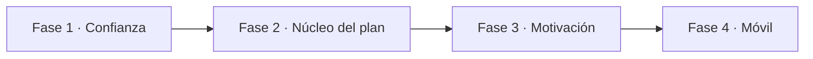

# HabitTracker Nexus — Documento de mejoras y funcionalidades

> Versión: 2026-10-30 · Autor: Juan
> Uso: documento de referencia para el agente y el equipo. **Es un banco de propuestas: no invalida lo ya implementado.** Las decisiones finales las toma el autor.
> Diseño visual relacionado: [`diseno-ui-web-movil.md`](./diseno-ui-web-movil.md)

## Índice

1. [Propósito y alcance](#1-propósito-y-alcance)
2. [Visión del producto](#2-visión-del-producto)
3. [Modelo de acceso: público vs. con sesión](#3-modelo-de-acceso-público-vs-con-sesión)
4. [Módulo HabitTracker](#4-módulo-habittracker-negocio-principal)
5. [AccessControl y Permissions](#5-accesscontrol-y-permissions)
6. [Auditing, DocumentManager, Notifications y Reports](#6-auditing-documentmanager-notifications-y-reports)
7. [Privacidad, cumplimiento y derechos del usuario](#7-privacidad-cumplimiento-y-derechos-del-usuario)
8. [Transversales técnicos y app móvil](#8-transversales-técnicos-y-preparación-para-la-app-móvil)
9. [Priorización y hoja de ruta](#9-priorización-y-hoja-de-ruta)

---

## 1. Propósito y alcance

Este documento es un **banco de propuestas** para la fase final del proyecto, después de completar las prácticas del curso. **No invalida nada de lo ya implementado**: cada propuesta se suma sobre los módulos existentes (AccessControl, Auditing, DocumentManager, HabitTracker, Notifications, Permissions, Reports) y respeta Clean Architecture, DDD con dominio rico, SOLID y la separación por módulos.

Cómo leerlo:

- Cada propuesta lleva una **prioridad** (P1 = imprescindible para un producto real, P2 = alto valor, P3 = diferenciador o futuro) y un **esfuerzo** estimado (S, M, L).
- Las propuestas se describen en términos de dominio (agregados, eventos, casos de uso) para que el agente de arquitectura y el autor puedan evaluarlas y descartar las que no aporten.
- Los roles actuales son **Administrador** y **Usuario estándar**; donde se sugiere un rol nuevo, se marca como opcional.
- La sección 9 propone un orden, no lo impone.

## 2. Visión del producto

**HabitTracker Nexus ayuda a cualquier persona a convertir una meta física o personal en un plan diario medible, y a sostenerlo en el tiempo.** El problema real no es la falta de información (sobra en internet), sino la constancia: la mayoría abandona en las primeras semanas porque no sabe qué hacer cada día, no ve su progreso y no tiene a nadie que le dé seguimiento.

Propuesta de valor en tres frases:

1. **Meta clara**: el usuario elige un objetivo (perder grasa, ganar masa muscular, correr 10 km, dormir mejor, reducir estrés) y la app lo convierte en un plan por semanas.
2. **Hábitos pequeños**: cada día recibe pocas tareas concretas (entrenar 30 min, 8 vasos de agua, 7 h de sueño) que se marcan en segundos.
3. **Progreso visible**: rachas, gráficas de peso y medidas, fotos de antes/después y reportes semanales que demuestran el avance.

### Perfiles de usuario

| Perfil | Necesidad principal | Qué le ofrece la app |
| --- | --- | --- |
| Principiante de gimnasio | Saber qué hacer y no lesionarse | Planes guiados por nivel, videos/descripciones de ejercicios |
| Deportista amateur (corredor, ciclista, futbolista) | Preparar una competencia o marca | Planes por fecha objetivo, registro de entrenamientos y cargas |
| Persona que quiere bajar de peso | Constancia en alimentación y actividad | Hábitos de nutrición, hidratación, pasos, seguimiento de peso |
| Persona enfocada en bienestar | Sueño, estrés, lectura, meditación | Hábitos no físicos dentro del mismo sistema |
| Entrenador o coach (futuro, opcional) | Dar seguimiento a varios alumnos | Asignar planes y ver el progreso de sus alumnos |
| Administrador | Operar la plataforma con seguridad | Gestión de usuarios, catálogo de planes, auditoría y reportes |

Áreas que cubre el producto: **Físico, Nutrición, Descanso, Mente y Productividad personal**.

## 3. Modelo de acceso: público vs. con sesión

**Regla: se puede explorar sin cuenta; para elegir una meta y seguir un plan hay que iniciar sesión y aceptar términos y privacidad.** Esto baja la barrera de entrada y protege los datos personales, que solo se guardan cuando hay consentimiento.

### Qué puede hacer cada visitante

| Funcionalidad | Visitante sin sesión | Usuario estándar | Administrador |
| --- | --- | --- | --- |
| Ver landing, beneficios, preguntas frecuentes | Sí | Sí | Sí |
| Explorar catálogo de metas y planes (vista previa) | Sí | Sí | Sí |
| Calculadoras públicas (IMC, calorías diarias, ritmo de carrera, agua) | Sí, sin guardar | Sí, y se guardan en su perfil | Sí |
| Biblioteca de ejercicios y artículos | Sí | Sí | Sí, y la gestiona |
| Elegir una meta e iniciar un plan | No: pide registro | Sí | Sí |
| Registrar hábitos, entrenamientos, peso y fotos | No | Sí | Sí (su propia cuenta) |
| Reportes y logros personales | No | Sí | Sí |
| Panel de administración | No | No | Sí |

### Flujo de registro propuesto

1. El visitante explora y pulsa **"Empezar este plan"**.
2. Se le ofrece **Continuar con Google** o correo y contraseña (ver sección 5).
3. Antes de crear la cuenta acepta **Términos de uso** y **Política de privacidad** con casillas separadas y sin marcar por defecto; el consentimiento opcional para correos de marketing va aparte.
4. Verificación de correo (si usó correo y contraseña).
5. **Onboarding de 4 pasos**: datos básicos (edad, sexo, altura, peso), nivel de actividad, disponibilidad semanal (días y minutos) y aviso de salud ("consulta a un médico si tienes condiciones previas").
6. La meta elegida al principio se conserva y se genera el plan; el usuario aterriza en su panel "Hoy".

### Páginas legales y de confianza

- Términos de uso, Política de privacidad, Política de cookies y Aviso de salud, versionados: el dominio guarda qué versión aceptó cada usuario y cuándo (`ConsentRecord`).
- Si una política cambia, se pide aceptar la nueva versión en el siguiente inicio de sesión.
- Centro de privacidad dentro del perfil: ver datos, descargarlos, revocar consentimientos y eliminar cuenta (sección 7).
- Banner de cookies con opción real de rechazar las no esenciales.

## 4. Módulo HabitTracker (negocio principal)

**El módulo pasa de "registrar hábitos" a "seguir un plan con meta, medir el progreso y no abandonar".** Las propuestas están agrupadas por capacidad; cada una indica agregados o eventos de dominio sugeridos.

### 4.1 Metas y planes

| Propuesta | Detalle | Prioridad | Esfuerzo |
| --- | --- | --- | --- |
| Catálogo de metas | Metas tipificadas por área (Físico, Nutrición, Descanso, Mente, Productividad) con nivel (principiante, intermedio, avanzado). Agregado `Goal` con valor objetivo, unidad y fecha límite. | P1 | M |
| Planes por plantillas | `PlanTemplate` creado por el admin (ej. "Perder 5 kg en 12 semanas", "Primeros 5 km", "Fuerza 3 días"). Al iniciarlo se genera un `UserPlan` con semanas, días y tareas. | P1 | L |
| Metas SMART propias | El usuario crea su meta personalizada validada por el dominio (medible, con fecha, alcanzable). | P2 | M |
| Ajuste del plan | Si el usuario falla varios días, el plan propone reprogramar o bajar la carga, en vez de dejarlo "en rojo". Evento `PlanAdjusted`. | P2 | M |
| Pausa justificada | Pausar el plan por lesión, viaje o enfermedad sin perder la racha. | P2 | S |
| Varias metas a la vez | Hasta 3 metas activas, con una marcada como principal. | P3 | S |

### 4.2 Hábitos y registro diario

| Propuesta | Detalle | Prioridad | Esfuerzo |
| --- | --- | --- | --- |
| Panel "Hoy" | Lista de tareas del día con marcado en un toque, progreso del día y próxima tarea. | P1 | M |
| Tipos de hábito | Sí/No, cantidad (vasos, pasos, páginas), duración (minutos) y hábitos negativos a evitar (azúcar, tabaco). | P1 | M |
| Frecuencia flexible | Diario, días específicos, X veces por semana. | P1 | S |
| Recordatorios por hábito | Hora configurable; se apoyan en el módulo Notifications. | P1 | S |
| Rachas con tolerancia | Racha actual y récord, con "días de gracia" limitados para no castigar un solo fallo. | P2 | S |
| Notas y estado de ánimo | Nota corta y energía/ánimo del 1 al 5 por día; útil para correlaciones en reportes. | P3 | S |
| Registro sin conexión | Guardar en el dispositivo y sincronizar después (clave para la app móvil). | P2 | L |

### 4.3 Entrenamiento

| Propuesta | Detalle | Prioridad | Esfuerzo |
| --- | --- | --- | --- |
| Biblioteca de ejercicios | Nombre, grupo muscular, equipo necesario, nivel, instrucciones e imagen o video (archivos en DocumentManager). Pública en modo lectura. | P1 | M |
| Rutinas | Rutina = lista de ejercicios con series, repeticiones, peso y descanso. | P1 | M |
| Registro de sesión | Series reales, peso levantado, RPE (esfuerzo percibido) y duración; temporizador de descanso. | P1 | M |
| Récords personales | Detectar automáticamente un nuevo máximo (evento `PersonalRecordAchieved`). | P2 | S |
| Cardio | Distancia, tiempo y ritmo para correr, ciclismo, natación. | P2 | S |
| Progresión automática | Sugerir subir peso o repeticiones cuando se cumplen las series objetivo. | P3 | M |
| Integración con relojes | Importar pasos, frecuencia cardíaca y entrenamientos (Health Connect en Android, Apple Health en iOS). | P3 | L |

### 4.4 Nutrición, hidratación y descanso

- **Objetivo calórico y de macros** calculado a partir del onboarding y la meta (P2, M). Se presenta como estimación, no como prescripción médica.
- **Registro simple de comidas** por porciones o "plato saludable" en lugar de contar cada caloría (P2, M).
- **Hidratación** con meta diaria en vasos o ml (P1, S).
- **Sueño**: hora de acostarse y levantarse, horas dormidas y calidad (P2, S).

### 4.5 Progreso y medición

- Registro de **peso, % de grasa y medidas corporales** (cintura, pecho, brazo, pierna) con gráficas en el tiempo (P1, M).
- **Fotos de progreso privadas** (frente, perfil, espalda) en DocumentManager con acceso solo del dueño; comparador antes/después (P2, M).
- **Línea de tiempo de la meta**: dónde estoy vs. dónde debería estar según el plan (P1, S).
- **Revisión semanal automática**: cumplimiento, récords y recomendación para la semana siguiente (P2, M), generada con Reports y enviada por Notifications.

### 4.6 Motivación y comunidad

- **Logros e insignias** por rachas, primera meta cumplida, 100 entrenamientos, etc. (P2, S).
- **Niveles y puntos** ligados a la constancia, no al peso perdido, para no incentivar conductas poco sanas (P3, S).
- **Retos** de 7, 21 o 30 días creados por el admin, con tabla de participantes opcional (P3, M).
- **Compañero de responsabilidad**: un amigo ve solo tu cumplimiento, nunca tus datos de salud (P3, M).
- **Modo coach** (rol opcional futuro): un entrenador asigna planes y ve el progreso de sus alumnos con consentimiento explícito (P3, L).

### 4.7 Salud y seguridad del usuario

- Aviso de salud obligatorio en el onboarding y en planes de alta intensidad.
- Límites de dominio: rechazar metas de pérdida de peso extremas (por ejemplo, más de ~1 % del peso corporal por semana) u objetivos calóricos muy bajos; el dominio explica por qué.
- Lenguaje neutral y positivo; evitar comparaciones corporales entre usuarios.

### 4.8 Modelo de dominio sugerido

- **Agregados**: `Goal`, `PlanTemplate`, `UserPlan`, `Habit`, `HabitLog`, `Workout`, `Exercise`, `BodyMeasurement`, `Challenge`, `Achievement`.
- **Value objects**: `Weight`, `Distance`, `Duration`, `Frequency`, `Streak`, `MacroTarget`.
- **Eventos de dominio**: `GoalStarted`, `HabitCompleted`, `StreakBroken`, `PersonalRecordAchieved`, `GoalAchieved`, `PlanAdjusted`. Los consumen Notifications (mensajes), Auditing (traza) y Reports (estadísticas), sin acoplar módulos.

## 5. AccessControl y Permissions

**Prioridad: inicio de sesión con Google, verificación de correo y sesiones seguras; el resto endurece lo que ya existe.**

### 5.1 AccessControl (identidad y sesiones)

| Propuesta | Detalle | Prioridad | Esfuerzo |
| --- | --- | --- | --- |
| Continuar con Google | OAuth 2.0 / OpenID Connect con Authorization Code + PKCE. El backend valida el ID token y crea o vincula el usuario. Entidad `ExternalLogin` (proveedor, subject) asociada al `User`. | P1 | M |
| Vincular cuentas | Si el correo de Google ya existe con contraseña, pedir confirmación antes de vincular (evita apropiación de cuentas). | P1 | S |
| Más proveedores | Apple (exigido en iOS si se ofrece login social), Microsoft o Facebook. Diseñar `ExternalLogin` genérico desde el inicio. | P3 | S c/u |
| Verificación de correo | Token de un solo uso con expiración; cuentas sin verificar con acceso limitado. | P1 | S |
| Recuperar contraseña | Autoservicio por correo (complementa el "Forzar restablecimiento" del admin). | P1 | S |
| Política de contraseñas | Mínimo 12 caracteres, comprobación contra contraseñas filtradas, sin reglas de complejidad absurdas. | P1 | S |
| Bloqueo por intentos | Bloqueo temporal tras N intentos fallidos y limitación por IP. | P1 | S |
| Tokens | Access token corto (~15 min) + refresh token rotativo en cookie HttpOnly/Secure/SameSite en web; almacenamiento seguro del sistema en móvil. | P1 | M |
| Sesiones activas | El usuario ve sus dispositivos y puede cerrar sesión en todos. | P2 | M |
| MFA | TOTP obligatorio para administradores y opcional para usuarios. | P2 | M |
| Passkeys | Inicio de sesión sin contraseña con WebAuthn. | P3 | M |

### 5.2 Permissions (autorización)

- **Permisos granulares por acción** (`users.read`, `users.deactivate`, `plans.publish`, `reports.export`); los roles son conjuntos de permisos (P1, M).
- **Políticas basadas en recursos**: un usuario solo accede a sus propios hábitos, fotos y mediciones; se verifica en la capa de aplicación, no solo en el frontend (P1, S).
- **Roles opcionales a futuro**: Coach y Moderador de contenido (P3, M).
- **Protecciones del admin**: impedir que un admin se quite su propio rol o desactive al último administrador; la UI actual ya bloquea editar el propio rol, extender la regla al dominio (P1, S).
- **Matriz de permisos visible** en el panel de admin (P2, S).

## 6. Auditing, DocumentManager, Notifications y Reports

**Estos módulos pasan de soporte genérico a servir directamente al negocio de HabitTracker**, reaccionando a sus eventos de dominio.

### 6.1 Auditing

- **Registro automático de acciones sensibles**: inicio de sesión, cambio de rol, desactivación, forzar restablecimiento, exportación y eliminación de datos (P1, M).
- Cada entrada guarda quién, qué, cuándo, desde dónde (IP, dispositivo), valor anterior y nuevo; **inmutable** (solo inserción) (P1, S).
- **Pantalla de Auditoría** con filtros por usuario, acción y fecha, y exportación CSV (P2, M).
- **Historial de seguridad para el usuario**: últimos inicios de sesión y alertas de acceso desde un dispositivo nuevo (P2, S).
- Retención configurable (ej. 12 meses) y anonimización de registros de cuentas eliminadas (P2, S).

### 6.2 DocumentManager

- **Fotos de progreso privadas** y adjuntos con almacenamiento en blob (Azure Blob / S3) y URLs firmadas de corta duración (P1, M).
- Validación de tipo y tamaño, eliminación de metadatos EXIF (GPS) y miniaturas (P1, S).
- **Medios de la biblioteca de ejercicios** gestionados por el admin (P2, S).
- **Documentos legales versionados** enlazados a `ConsentRecord` (P1, S).
- Cuota por usuario y borrado en cascada al eliminar cuenta (P2, S).

### 6.3 Notifications

| Propuesta | Detalle | Prioridad | Esfuerzo |
| --- | --- | --- | --- |
| Canales | Correo (ya existe cola), notificaciones en la app y push (web push y móvil con FCM/APNs). | P1 | M |
| Recordatorios de hábitos | Programados según la zona horaria del usuario. | P1 | M |
| Mensajes por evento | Felicitar récords, avisar racha en riesgo ("te queda hoy para no perder 12 días"), meta cumplida. | P2 | S |
| Preferencias | Canal, horario silencioso y tipo de mensaje; baja de marketing en un clic. | P1 | S |
| Plantillas | Editables por el admin con variables y vista previa. | P2 | M |
| Fiabilidad | Patrón outbox, reintentos con backoff y cola de errores visible en "Cola de correos". | P1 | M |

### 6.4 Reports

- **Para el usuario**: resumen semanal y mensual, cumplimiento por hábito, evolución de peso y medidas, mapa de calor de constancia, exportación PDF (P1, M).
- **Para el administrador**: usuarios activos, retención a 7 y 30 días, metas más populares, abandono por plan y embudo registro → primera tarea → primera semana completa (P2, M).
- Métricas desde eventos de dominio en un modelo de lectura separado (CQRS) (P2, L).
- Reportes de admin con **datos agregados y anonimizados** (P1, S).

## 7. Privacidad, cumplimiento y derechos del usuario

**El usuario es dueño de sus datos: puede verlos, descargarlos, corregirlos, revocar permisos y eliminar su cuenta cuando quiera, desde la propia app.** Peso, medidas, fotos y sueño son datos de salud y merecen el nivel más alto de protección.

### 7.1 Derechos dentro del Centro de privacidad

| Derecho | Cómo se implementa | Prioridad |
| --- | --- | --- |
| Acceso y portabilidad | "Descargar mis datos": ZIP con JSON/CSV de hábitos, entrenamientos, mediciones y fotos; aviso por correo cuando esté listo. | P1 |
| Rectificación | Editar perfil y corregir registros históricos. | P1 |
| Revocar consentimientos | Activar/desactivar marketing, compartir con compañero o coach, análisis de uso. | P1 |
| Eliminación de cuenta | Confirmación (contraseña o Google), periodo de gracia de 14–30 días, luego borrado definitivo de datos y archivos; la auditoría se anonimiza. | P1 |
| Desactivación temporal | Pausar la cuenta sin borrar datos. | P2 |

El borrado se modela como caso de uso con eventos `AccountDeletionRequested` / `AccountDeleted` que cada módulo consume para limpiar lo suyo, sin que AccessControl conozca las tablas de los demás.

### 7.2 Buenas prácticas de protección

- **Minimización**: pedir solo lo necesario; fecha de nacimiento y sexo opcionales con explicación de su uso.
- **Cifrado** en tránsito (TLS) y en reposo para campos sensibles y archivos.
- **Separación de acceso**: el admin gestiona cuentas pero no ve fotos ni mediciones individuales.
- **Registro de consentimientos** con versión, fecha e IP.
- **Edad mínima** (ej. 16 años) en los términos.

### 7.3 Marco normativo a revisar

Alinear con la **Ley 172-13 de República Dominicana sobre protección de datos de carácter personal**, y tomar el **RGPD europeo** como referencia si se apunta a usuarios internacionales. Google Play y App Store exigen que la eliminación de cuenta pueda iniciarse dentro de la app. Este documento no es asesoría legal.

## 8. Transversales técnicos y preparación para la app móvil

**La app móvil reutilizará la misma API; el backend debe quedar versionado, documentado y listo para clientes sin conexión desde ahora.**

### 8.1 API y backend

- **Versionado** (`/api/v1/...`) y contrato OpenAPI publicado; el agente `frontend-api-contract` puede generar tipos TypeScript desde él (P1, S).
- **Errores estándar** con Problem Details (RFC 9457) (P1, S).
- **Paginación, filtros y búsqueda** consistentes (P1, S).
- **Idempotencia** en registros diarios (usuario + hábito + fecha) (P1, S).
- **Sincronización offline**: endpoints de cambios desde una marca de tiempo; "última escritura gana" por registro (P2, L).
- **Zona horaria del usuario** en el perfil (P1, S).
- **Comunicación entre módulos** solo por eventos de integración o interfaces públicas; patrón outbox (P1, M).

### 8.2 Seguridad

- Cabeceras de seguridad (CSP, HSTS, X-Content-Type-Options), CORS restringido y protección CSRF (P1, S).
- Rate limiting en login, registro, recuperación y exportaciones (P1, S).
- Secretos fuera del repositorio (variables de entorno / Key Vault) (P1, S).
- Revisión con el agente `ciberseguridad-pentester` sobre OWASP Top 10 y ASVS antes de entregar (P1, M).

### 8.3 Frontend web

- **Responsive y PWA** instalable como paso previo a la app nativa (P2, M).
- **Accesibilidad** WCAG 2.2 AA (P1, M).
- **Internacionalización**: español por defecto, listo para inglés (P2, M).
- **Modo oscuro** basado en tokens (P3, S).
- Estados vacíos, de carga y de error en cada pantalla; hoy varias secciones del admin están como "PRONTO" (P1, S).

### 8.4 Calidad, observabilidad y despliegue

- Pruebas unitarias del dominio, integración por módulo con base de datos en contenedor y E2E de los flujos principales (registro con Google, iniciar plan, marcar hábito, eliminar cuenta) (P1, M).
- Pruebas de arquitectura (NetArchTest o ArchUnitNET) que verifiquen que los módulos no se referencian entre sí (P2, S).
- Logs estructurados, OpenTelemetry y health checks (P2, M).
- CI/CD en GitHub Actions con despliegue a staging (P2, M).

### 8.5 App móvil (fase futura)

- **Tecnología sugerida**: React Native con Expo para reutilizar TypeScript y los tipos de la API (alternativas: .NET MAUI o Flutter).
- Funciones propias: push, widget de "hábitos de hoy", registro sin conexión, biometría, Health Connect / Apple Health.
- Navegación por pestañas: Hoy, Plan, Entrenar, Progreso, Perfil.

## 9. Priorización y hoja de ruta

**Recomendación: antes de entregar, completar la Fase 1 (confianza y privacidad) y lo esencial de la Fase 2 (seguir un plan); lo demás queda como evolución documentada.**

| Fase | Enfoque | Cuándo | Contenido |
| --- | --- | --- | --- |
| 1 | Confianza | Antes de entregar | Login con Google, verificación de correo, aceptación de términos, exportar y eliminar datos, auditoría de acciones sensibles |
| 2 | Núcleo del plan | Antes de entregar | Metas y plantillas, panel Hoy y rachas, rutinas y sesiones, peso y medidas, recordatorios |
| 3 | Motivación | Si queda tiempo | Revisión semanal, logros e insignias, fotos de progreso, reportes de admin, MFA para admins |
| 4 | Móvil | Después del curso | PWA instalable, API v1 y offline, app React Native, push y widget, Health Connect |

La Fase 1 va primero porque registrar usuarios reales con datos de salud exige consentimiento, verificación y derecho a eliminar antes que cualquier funcionalidad atractiva.

### Criterios para decidir qué entra

- ¿Resuelve el problema central (constancia hacia una meta)? Si no, baja de prioridad.
- ¿Se puede demostrar de punta a punta (registro → plan → hábito marcado → progreso)?
- ¿Respeta los límites de módulo? Si acopla dos módulos, rediseñar con eventos.
- ¿Tiene pruebas de dominio que lo respalden?

### Demo sugerida para la entrega (5 minutos)

1. Visitante explora metas y usa la calculadora de calorías sin cuenta.
2. Elige "Primeros 5 km", entra con Google y acepta términos.
3. Completa el onboarding y llega al panel Hoy.
4. Marca hábitos, registra un entrenamiento y ve la racha subir.
5. El admin revisa usuarios y la auditoría del registro.
6. El usuario descarga sus datos y solicita eliminar su cuenta.
